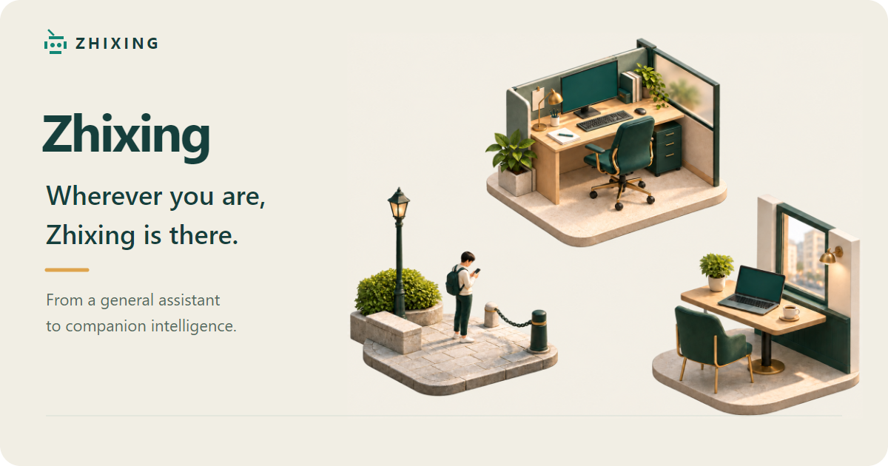

<picture>
  <source media="(prefers-reduced-motion: reduce)" srcset="assets/brand/readme-hero.en-static.png">
  
</picture>

<p>
  <a href="#getting-started">Getting started</a> · <a href="packages/cli/README.md">User guide</a> · <a href="#data-and-permissions">Data and permissions</a> · <a href="#help-and-contributing">Help and contributing</a> ｜ <a href="README.md">中文</a>
</p>

**Zhixing** (知行) is a general-purpose personal agent that runs on your own devices and serves both your life and your work. You talk to it in the terminal or a connected message channel, and it takes real action within the scope you authorize. Your own devices hold its state, and you choose the model. Our long-term direction is companion intelligence that goes wherever you are; see the [product philosophy](docs/philosophy.md) (in Chinese).

The interface and command help are currently in Chinese.

## What it can do

- **Pick up any conversation.** Conversations and history are stored on your devices. Zhixing reopens the most recent conversation at startup, and you can create, switch, rename, or clear conversations.
- **Work in folders you authorize.** Create a work scene for a folder and authorize it. Zhixing can then read and write files, search content, and run commands there. Actions with real effects follow your trust and confirmation settings.
- **Organize and follow through.** Task lists, scheduled tasks, multi-perspective review (triggered with @), and subtasks for complex work. Scheduled tasks run on the running duty device. A task missed while that device was not running is not run later.
- **Extend it your way.** Use Skills to capture how you work, connect external tools through MCP, and have it read web pages you specify.
- **Use it in message channels.** Channels are connected on demand, and a Feishu adapter is included: configure a Feishu app and complete a one-time identity verification to talk to the same assistant in Feishu. For another platform, you can ask Zhixing to prepare a connection from that platform's official documentation; it is enabled after you confirm it and complete identity verification. Whether a platform can be connected depends on whether it offers the necessary interfaces.
- **Work across devices.** Pair a second device so tasks can run on the device that has the files and tools, as long as that device is online and the folder is authorized on it. You can also set up a recovery backup.

## Getting started

### Prerequisites

- Node.js 24 or later, with npm.
- An API key for a model service. Initial setup currently offers [SiliconFlow (硅基流动)](https://cloud.siliconflow.cn/account/ak) and the [official DeepSeek API](https://platform.deepseek.com/api_keys). The provider charges for usage and receives your requests and related content.
- A supported operating system; see the [release notes](docs/delivery/releases/0.1.0.md).

### Install and start

```text
npm install -g zhixing
zz
```

`zz` and `zhixing` are the same command.

### Initial setup

The first run opens a setup screen. Use ↑↓ to move, Enter to confirm, and Esc to go back.

1. Under “对话模型” (chat model), choose a provider, add a model ID, and enter the API key. This section is required. The key is stored only in your device's local credential store and is never written to the configuration file.
2. You can skip “消息通道” (message channels, such as Feishu) and “MCP 服务” (MCP services) for now and add them later with `/config`.

### First task

After setup you are in a conversation. Start with a plain request, for example:

> I'm giving a quarterly review next week. List the preparation steps and put them in order.

To work with files in a folder, first create and authorize a work scene:

1. Type `/work` and press Ctrl+N to create a work scene.
2. Describe the purpose and the folder's full path, for example “organize the reading notes in D:\Notes”.
3. Check the proposed scene name and folder. When you confirm, Zhixing creates the scene and authorizes that folder.
4. Type `/work` again, select the scene, and press Enter to enter it.
5. Start with a read-only request, for example “list the files and folders at the top level of this folder without changing anything”.

## Everyday use

| To | Use |
|---|---|
| See all commands | `/help` |
| Start a new conversation / return to an earlier one | `/new` / `/resume` |
| Change the model, Feishu, MCP, or other settings | `/config` |
| Enter, create, or manage work scenes | `/work` |
| Leave | `/exit` returns from a work scene to the main conversation; in the main conversation it closes the interface while Zhixing keeps running in the background |
| Stop Zhixing | `/stop`, or `zz stop` in a shell |
| Check status / diagnose problems | `zz status` / `zz doctor` |

For connecting message channels, pairing devices, recovery backups, upgrading, and uninstalling while keeping your data, see the [user guide](packages/cli/README.md) (in Chinese).

## Data and permissions

- Conversations, configuration, and runtime state are stored on your devices, by default under `~/.zhixing` on each device. API keys and other credentials stay in the local credential store of the device they belong to.
- Your requests, relevant file contents, and tool results are sent to the model provider you configure. MCP services, Feishu, and other external services handle data under their own terms and may charge you.
- Zhixing really changes files and runs commands. Trust, permission, and confirmation settings decide which actions need your approval, but they are not an operating-system sandbox. Authorize only the folders you need.

Read the [security policy](SECURITY.md) for details. Report security vulnerabilities [privately to the maintainers](https://github.com/Tandem-Agents/zhixing/security/advisories/new). Do not disclose vulnerability details or sensitive information in public issues.

## Help and contributing

- If something goes wrong, run `zz doctor` first. It checks your local configuration and runtime state and suggests the next step.
- If that does not solve it, [open an issue](https://github.com/Tandem-Agents/zhixing/issues). Include the output of `zz --version` and a sanitized description of what happened. Do not include credentials or unreviewed full logs.
- To contribute, read the [contributing guide](CONTRIBUTING.md) and the [Code of Conduct](CODE_OF_CONDUCT.md). For the overall design, see the [architecture overview](research/design/architecture/overview.md) (in Chinese). The [release notes](docs/delivery/releases/0.1.0.md) describe what each version contains and changes.

---

<p align="center">
  Understanding informs action. Action deepens understanding.<br>
  <a href="LICENSE">MIT License</a> · <a href="assets/brand/readme-hero.en-static.png">Static image</a>
</p>
