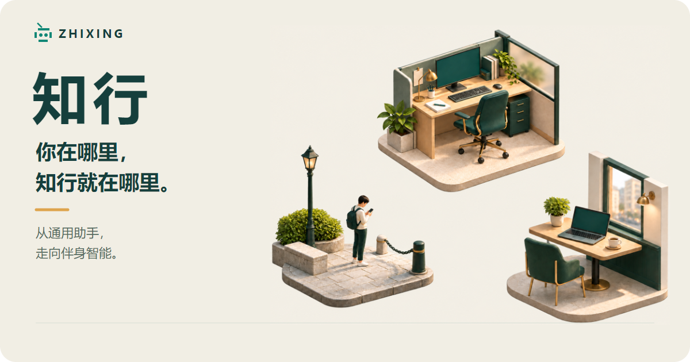

<picture>
  <source media="(prefers-reduced-motion: reduce)" srcset="assets/brand/readme-hero-static.png">
  
</picture>

<p>
  <a href="#开始使用">开始使用</a> · <a href="packages/cli/README.md">使用指南</a> · <a href="#数据与权限">数据与权限</a> · <a href="#求助与参与">求助与参与</a> ｜ <a href="README.en.md">English</a>
</p>

**知行**（Zhixing）是运行在你自己设备上的通用个人智能体，服务生活与工作。你在终端或已接入的消息通道里与它对话，它在你授权的范围内真正动手做事；状态由你自己的设备保存，模型由你选择。我们的长期方向是随你而行的伴身智能，详见[产品哲学](docs/philosophy.md)。

## 它能做什么

- **对话随时接着聊**：对话和历史保存在你的设备上。重新打开时会自动回到最近的对话，也可以新建、切换、命名或清空。
- **在授权的目录里干活**：为一个目录建立工作场景并授权后，它可以读写文件、搜索内容、执行命令。有实际影响的操作，按你的信任与确认设置执行。
- **安排和推进事务**：支持任务清单、定时任务、多视角评议（输入 @ 触发），复杂工作可以拆成子任务。定时任务由正在运行的值班设备执行，设备没有运行时错过的任务不会补跑。
- **按你的方式扩展**：用 Skills 沉淀做事方法，用 MCP 接入外部工具，也能读取指定网页。
- **在消息通道里使用**：消息通道按需接入，已有飞书适配；配置飞书应用并完成一次本人验证后，就能在飞书里和同一个助手对话。需要其他平台时，可以让知行依据该平台的官方资料准备接入，经你确认并完成本人验证后启用；能否接入取决于平台是否开放相应接口。
- **多设备协作**：配对第二台设备后，任务可以交给拥有所需文件和工具的设备执行，前提是那台设备在线，并已在它上面授权相应目录；也可以建立恢复备份。

## 开始使用

### 准备

- Node.js 24 或更高版本，以及 npm。
- 一个模型服务的 API Key。首次配置目前可以选择[硅基流动](https://cloud.siliconflow.cn/account/ak)或 [DeepSeek 官方](https://platform.deepseek.com/api_keys)。调用费用由服务商收取，你的请求和相关内容会发送给所选服务商。
- 支持的操作系统见[版本说明](docs/delivery/releases/0.1.0.md)。

### 安装并启动

```text
npm install -g zhixing
zz
```

`zz` 和 `zhixing` 是同一个命令。

### 首次配置

第一次运行会打开配置界面，用 ↑↓ 选择、Enter 确认、Esc 返回：

1. 在“对话模型”中选择服务商，添加模型 ID，填写 API Key。这一项是必填的。API Key 只保存在本机的凭据存储里，不会写入配置文件。
2. “消息通道”（如飞书）和“MCP 服务”可以先跳过，以后用 `/config` 补上。

### 第一个任务

配置完成后进入对话。先直接提一个请求，例如：

> 我下周要做一次季度汇报，帮我列出准备步骤，并按先后排好。

要处理某个目录中的文件，先建立并授权工作场景：

1. 输入 `/work`，按 Ctrl+N 新建工作场景。
2. 描述用途和目录的完整路径，例如“整理 D:\Notes 里的读书笔记”。
3. 核对它给出的场景名称和目录。确认后，它会创建场景并授权这个目录。
4. 再次输入 `/work`，选中这个场景，按 Enter 进入。
5. 先让它只读查看，例如“列出这个目录顶层的文件和文件夹，先不要修改任何内容”。

## 继续使用

| 想做的事                   | 怎么做                                                              |
| -------------------------- | ------------------------------------------------------------------- |
| 查看全部命令               | `/help`                                                           |
| 新对话 / 回到以前的对话    | `/new` / `/resume`                                              |
| 修改模型、飞书、MCP 等配置 | `/config`                                                         |
| 进入、新建或管理工作场景   | `/work`                                                           |
| 退出                       | `/exit`：在工作场景中回到主对话；在主对话中关闭界面，后台继续运行 |
| 停止知行                   | `/stop`，或在命令行运行 `zz stop`                               |
| 查看运行状态 / 排查问题    | `zz status` / `zz doctor`                                       |

消息通道接入、多设备配对、恢复备份、升级与卸载（卸载时保留数据），见[使用指南](packages/cli/README.md)。

## 数据与权限

- 对话、配置和运行状态保存在你的设备上，每台设备默认位于 `~/.zhixing`。API Key 等凭据只保存在所属设备本地的凭据存储里。
- 你的请求、相关文件内容和工具结果会发送给所配置的模型服务商。MCP 服务、飞书等外部服务按各自的规则处理数据，也可能产生费用。
- 知行会真实地修改文件、执行命令。信任、权限和确认设置决定哪些操作需要你确认，但它们不是操作系统级的沙箱，请只授权需要的目录。

详见[安全说明](SECURITY.md)。发现安全漏洞，请通过[私密漏洞报告](https://github.com/Tandem-Agents/zhixing/security/advisories/new)联系维护者，不要在公开 Issue 中披露漏洞细节或敏感信息。

## 求助与参与

- 使用中遇到问题，先运行 `zz doctor`：它会检查本机的配置和运行状态，并给出下一步做法。
- 仍未解决的话，请[提交 Issue](https://github.com/Tandem-Agents/zhixing/issues)，附上 `zz --version` 的输出和脱敏后的现象。不要附凭据或未经检查的完整日志。
- 想参与开发，请阅读[开发与贡献指南](CONTRIBUTING.md)和[行为准则](CODE_OF_CONDUCT.md)。想了解整体设计，请阅读[架构概述](research/design/architecture/overview.md)。各版本的内容与变化见[版本说明](docs/delivery/releases/0.1.0.md)。

---

<p align="center">
  知而后行，行而后知。<br>
  <a href="LICENSE">MIT License</a> · <a href="assets/brand/readme-hero-static.png">静态图</a>
</p>
