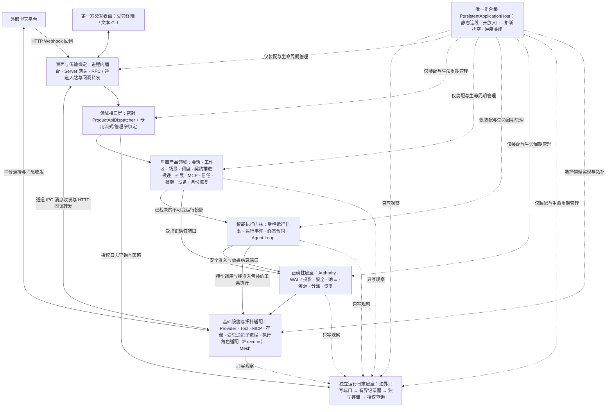

# 知行架构概述

本文是知行当前整体生产架构现状的唯一核心概述，只陈述已落地的系统结构、责任边界与运行机制，并作为进入各模块详细设计的总入口。产品愿景与长期架构演进方向分别以[愿景](../vision.md)和[架构演进方向](./evolution-direction.md)为准。

## 架构中心与正交边界

知行是运行在用户自有设备上的可独立部署个人智能体。命令行终端、消息通道、模型适配、运行内核与跨设备协同都服务于同一个个人助手产品，而不是各自构成独立产品。

现行架构的核心判断是：

> **知行的统一身份由唯一的产品语义、权威事实与共同应用行为构成；智能执行内核（Intelligence Kernel）是受控的认知执行者；终端、消息通道、网络网关与多台设备只是同一知行的交互表面与运行位置。**

系统含义不由某家模型、某个进程、网关或物理存储反向定义。围绕这一中心，全局结构沿三条正交变化边界隔离演进影响：

| 变化轴 | 保持稳定的契约 | 允许独立替换或演进的部分 | 明确不得渗透的内容 |
|---|---|---|---|
| 产品领域轴 | 产品语义、应用规则、状态所有权 | 具体领域模块及其内部实现 | 模型 SDK、传输协议、文件路径、物理设备拓扑 |
| 智能执行轴 | 受控运行信封、运行事件与终态合同 | 模型、Provider、循环细节与工具实现 | 会话、工作场景、日程调度等业务领域规则 |
| 接入与部署轴 | 表面绑定合同、调用身份与生命周期 | 终端界面、消息通道、传输协议、存储与单机/多设备拓扑 | 业务状态机副本与第二事实源 |

## 全局结构与责任边界

下图展示系统的**全局逻辑责任分层、运行期受控端口交互与宿主装配关系**（实线表示运行期沿受控端口的调用、入站路由与通道交互，虚线表示只写观察或启动期静态装配；物理包边界与编译期依赖见后文“当前物理形态与能力边界”）：



`PersistentApplicationHost` 被刻意置于产品请求调用链之外：它在启动期可见具体实现并完成静态连线，但请求进入系统后只能沿领域公开接口、智能内核合同与正确性端口推进，绝不回到宿主查找服务或编排业务。

### 七类责任边界

| 责任区域 | 固有职责 | 明确不拥有 |
|---|---|---|
| ApplicationHost | 冻结启动配置与按组件最小用途裁剪的只读凭据切片（秘密投影），规划设备角色拓扑，静态装配组件并管理启动、排空与关闭生命周期 | 产品业务用例、领域事实状态、运行期服务定位器 |
| Domain（产品领域） | 拥有产品合同、业务裁决、状态机/Reducer、事实语义，以及面向智能内核与交互表面的稳定投影 | RPC 方法命名、磁盘物理路径、模型 SDK、设备连接拓扑 |
| Product API 与领域绑定 | 以构造期密封的 `ProductApiDispatcher` 组合通用查询/命令/事实事件，并配合专用流式与管理窄绑定提供传输无关的进程内或远端调用入口 | 业务类型的重复定义、状态变更逻辑、直接存储写入权 |
| Intelligence Kernel | 接收受控运行信封，驱动模型推理、工具调用、子 Agent、上下文窗口与单次运行资源释放，产出运行事件、效果提议与明确终态 | 会话、工作场景、日程等产品事实，以及宿主、表面或拓扑对象 |
| Correctness Substrate | 提供单写权威、耐久提交与重放、安全管线、确认交互、资源治理、跨设备分派（Assignment）、副作用结算与恢复原语 | 具体业务领域分支、用户交互文案、产品工作流 |
| Surface / Binding | 负责连接认证、协议编解码、通道入站转发、事件订阅、用户输入、界面渲染与确认呈现；遇到事件缺口时重查权威状态 | 业务状态机副本、直接写权威存储、用瞬时事件拼凑持久事实 |
| Infrastructure / Topology | 实现模型、工具、MCP、持久存储、受管扩展子进程、执行器与设备组网（Mesh）窄端口；独立日志底座管理运行观察证据 | 业务规则裁决、第二事实源、跨层万能插件能力 |

### 外部副作用约束与提交机制

一切产生外部后果的动作（无论由用户发起还是由模型提议）均须通过所属领域的业务裁决、安全/确认准入与资源生命周期治理，不存在绕过准入的直接执行旁路。按动作性质区分两类实际提交机制：

1. **需耐久结算的产品与执行动作**（对话运行、非只读工具调用、定时任务执行、跨通道消息投递）服从耐久控制闭环：
   ```text
   用户或模型意图
     → 领域应用裁决
     → 权威状态（Authority）或执行账本前置耐久记录
     → 安全 / 确认 / 资源准入
     → 受控外部效果执行
     → 结果或证据耐久提交
     → 产品事实发布与后置派生视图物化
   ```
   例如内核中的非只读工具调用必须经安全执行器验权与策略/确认准入，并在执行前后写入分派账本的副作用开始与结算记录，而非由内核无保护直调底层工具。
2. **本机配置与运行连接生命周期动作**（如 MCP 服务接入与配置编辑、本地公开配置与凭据更新）：经对应应用服务校验请求有效性与安全规则后，由配置文件锁或本地加密凭据库持久保存，随后另行完成运行时连接激活或宿主换代并依据运行状态返回生效结果，明确区分“配置已保存”与“运行已生效”。

围绕状态与副作用恢复，全局遵循两条硬边界：

- **事实事件与进展事件严格二分**：事实事件（`Fact Event`）只表达已完成耐久提交的产品事实；进展事件（`Progress Event`）只表达带运行身份与顺序号的瞬时执行进展，不能作为状态恢复或事实查询依据。
- **未知副作用诚实定格**：当崩溃、断连或超时导致会话执行或外部通道投递的真实结果无法确认时，系统将其显式定格为待消歧状态（`uncertain`），要求带版本栅栏的明确消歧，既不静默吞错也不盲目重放外部副作用。

## 生产运行与协同机制

### 进程分流与宿主启动

1. `zhixing` 包导出的 `zz` 与 `zhixing` 指向同一轻量命令行入口：交互式 TTY 默认拉起受管终端；非交互流、独立管理命令与后台服务按命令描述符分流，不误占交互屏幕。各进程入口先建立独立的运行观察身份，再进入所属生命周期。
2. 持久宿主支持显式前台（`foreground`）、按需拉起（`on-demand`）与受管常驻（`managed`）三种运行模式；完成配置检查与本地凭据解锁投影后，单进程只创建一个 `PersistentApplicationHost`。
3. 宿主启动时先建立设备容量预算，再执行设备组网与信任引导（若本机已被移出信任组待联网核销回收，或多设备配对后尚未建立跨机加密恢复根，则停留在对应受限引导流程，不进入常规业务装配）；随后按设备角色规划拓扑——主控宿主（`anchor-host`）、执行宿主（`executor-host`），或设备仅具表面角色、无需后台业务宿主时的 `disabled` 拓扑（直接退出宿主角色装配，不常驻后台空壳）。包含执行角色（`executor`）的拓扑先获取本机工作区独占租约，再按需动态装入对应角色模块。

### 单机/多机角色部署与权威归属

用户在任意可自主部署设备上安装的都是同一个知行包，单机与多设备只是角色在同进程或跨设备上的装配差异：

| 维度 | 值班主控角色（`anchor`） | 执行宿主角色（`executor`） | 接入表面角色（`surface`） |
|---|---|---|---|
| 部署形态 | 单机时与 `executor` 同进程装配；多设备时常驻在线设备运行 `anchor-host`（可按需兼任 `executor`） | 单机时同进程装配；多设备时在含真实工作区的设备运行 `executor-host`，经双向认证 Mesh 连接 | 受管终端、命令行或外部聊天通道客户端；纯表面设备无后台业务宿主（`disabled`） |
| 权威状态归属 | **全局域唯一写入权威**（全局会话名录、日程与全局任务登记、耐久投递队列、信任规则、技能/判据资产、受管扩展、设备关系），以及常规对话的默认 `owner` | 不持有全局域写实例；内置本地对话 `owner`（`localConversationOwner`），承载显式指定本机作用域的对话（`localConversationId`）以及纯执行宿主与主控离线期间独立运行的本机对话（全局类意图暂存，待重连收编时原子移交 `Anchor`），而默认单机同进程下的常规对话仍由 `Anchor` 任 `owner`；持有本机真实工作区绑定与本地凭据 | 不持有任何持久业务权威，仅维护有界显示投影与连接会话 |
| 运行与传输分工 | 负责控制面准入串行、派发、全局调度、通道宿主绑定，以及无法直连时的端到端加密盲中继；纯主控不直接跑用户任务 | 运行**完整知行 Runtime**，在本地工作区跑完整轮 `Run`（跨机交接粒度是完整 `Run` 而非单次工具调用），经本地持久账本按“未开始可重派、已封存仅回放结果、已开始但结果未知则定格待消歧”保障幂等提交与恢复 | 控制面请求（输入准入、状态读写）发往该对话当前 `owner`；高频数据面（流式输出、工具事件、确认交互）可直连时凭票据直连执行宿主，否则经 `Anchor` 中继 |

### 交互表面、网关绑定与客户端接入边界

- **终端四进程隔离**：默认交互终端拆分为四个进程——**入口监管进程（S）**负责环境准入、子进程拉起与退出收束；**Node 应用适配进程（N）**通过已认证连接消费产品接口与会话流，维护有界显示投影；**终端界面进程（U）**基于 OpenTUI/Solid 只消费精简界面协议负责渲染与输入，不持凭据、不访问业务存储；**原生恢复进程（R）**保存初始终端模式并在全部自有写者退出后兜底还原终端状态。关闭前台终端不会终止独立运行的 `PersistentApplicationHost`。
- **服务端网关双通路注入**：`@zhixing-ai/server` 不持有业务规则，按宿主角色接收构造期注入的 `ProductApiDispatcher`（主控汇集按宿主拓扑与已装配能力接入的各领域接口及日志查询，如设备关系管理仅在建立多机信任运行时后接入；纯执行宿主的本机服务仅暴露授权日志查询）以及受限专用绑定（主对话流式执行与历史回放、远程确认桥、外部通道回调与入站路由、分流本机与远端主控对话的第一方跨机会话路由，以及宿主/备份只读状态快照）。监听端点在处理器、连接管理与关闭回调全部就绪后才从 `503` 激活服务。
- **新表面接入现行合同**：新增第一方客户端表面（如桌面或 Web 界面）应复用 `@zhixing-ai/rpc` 客户端绑定连接 `@zhixing-ai/server`——通用业务查询/命令/事实事件订阅走密封 `ProductApiDispatcher`，交互流与历史回放走 `session-wire` 会话绑定，权限确认走 `confirmation-bridge` 确认桥，断线缺口后重查权威状态；新增外部聊天平台则按 `Channel` 受管扩展协议接入。任何表面均不得自建业务状态机或绕开上述公开绑定直连内部状态。

### 对话执行闭环、契约推进与执行拓扑透明

- **对话一轮执行的三个阶段**：
  1. **准入与不可变运行投影**：用户输入经终端适配进程（N）或通道入站路由提交至该对话唯一的当前 `owner` 完成串行准入立项，汇集工作场景（Workscene）、技能与信任快照生成不可变的运行投影。
  2. **运行装配与智能内核循环**：目标执行侧由 `@zhixing-ai/runtime-host` 装配模型、环境、工具、权限与窗口生命周期钩子，交由 `@zhixing-ai/orchestrator` 与 `@zhixing-ai/core` 的智能执行内核运行多轮模型推理与经安全/账本包装的工具管线；权限确认与中断取消分别经独立确认桥和取消控制链往返，上下文窗口按代际锁定稳定前缀并在容量边界触发切段压缩，模型瞬时故障重试由容错层隔离。
  3. **权威提交与后置派生投影物化**：运行正常完成时，执行侧经持久账本将结果交回对话 `owner` 执行权威提交——**权威事务一旦提交即构成不可回退的已提交事实**；对话转录读视图、注意力窗口与窗口快照随后作为可重驱的后置派生投影依次物化，后置投影若遇异常可从已提交记录恢复，绝不反向改判或撤销已提交运行。运行中断或异常失败时，系统耐久记录取消、失败或待消歧状态及已确认的结算证据（待消歧状态尚未终结，仍须继续核对消歧），未完成的运行输出不进入已提交对话转录与持久注意力窗口；需跨通道外发的已完成结果写入 `Delivery` 耐久投递账本，经通道发送层的进程内 `Outbox` 协调同目标发送尝试顺序（在发送失败、槽位超时或进程重启下不构成无条件的用户可见送达保序保证）。
- **统一运行合同与执行拓扑透明**：交互对话、定时轻量运行、本机耐久任务与远端执行器分派任务，统一服从同一组 `KernelRunEnvelope`、`KernelRunEvent` 与 `KernelRunCompletion` 合同（Turn、Run 与注意力窗口的定义见[生命周期概念定义与规范](./lifecycle-concepts.md)）。对话与任务执行的业务裁决及智能内核循环不因本机或远端执行而分叉（设备管理等本身以设备拓扑为业务对象的领域除外），执行路径仅在宿主派发适配边界切换。
- **契约推进（Advancement）**：针对需要多轮自主收敛的复杂目标，`Advancement` 领域先生成可核验的完成判据（Rubric）并经用户确认立项，随后驱动执行回合、调用独立审查模型按执行器验签取证的客观证据裁定是否达标，未达标时自动续推或在受阻时交回用户裁决。

### 受管扩展与外部通道

- **领域裁决与独立子进程隔离**：`Extension Management` 领域管理扩展实例、启用意图、固定制品摘要绑定及接入/更新/修复流程，统一经权威耐久提交并通过 Product API 暴露。`ManagedExtensions` 将外部适配作为独立 Node.js 24 ESM 子进程运行，经版本化 IPC 通信；子进程隔离用于生命周期管理与故障恢复，不等同于操作系统安全沙箱。
- **权限封顶与安全回滚**：外部扩展仅在既定能力类型协议（当前开放 `Channel` 通道类型）内动态接入，**不取得 `Product API` 注册权、核心服务查找权或权威状态写入权**；通道绑定在宿主侧对接会话、投递与确认链路，不在通用扩展底座中掺入具体平台分支。扩展子进程按平台机制建立外部连接（如当前内置飞书适配采用 SDK 长连接），普通消息经 IPC（`channel.message` / `channel.send`）进出宿主会话与投递链；平台 HTTP Webhook 请求则先经 `@zhixing-ai/server` 的 `/channels/{id}/...` 路由接收并由 IPC（`channel.http`）转发至扩展子进程处理（其中互动确认回调在子进程完成平台验签解析后，以 `channel.challenge-action` 回传核心确认链）。候选制品切换保留旧绑定以便验证失败时自动回退；设备值班迁移与灾备接管前核验制品摘要（缺失时可从匹配摘要的本地种子回填），平台密钥始终留在各设备本地加密存储中，不随权威状态跨机迁移。
- **飞书种子与离线工具包**：`@zhixing-ai/channel-feishu` 仅构建固定摘要的独立通道扩展制品与清单；CLI 随安装包携带该迁移种子及离线扩展开发与校验工具包（`extension-kit`），主进程不直接耦合飞书 SDK。

### 独立运行日志底座

`@zhixing-ai/core/logging` 将运行观察拆分为各组件边界的只写记录端口、共享有界缓冲记录器、独立于业务状态的运行日志存储（默认由入口进程拥有的独立子进程在容量预算内执行写事务与回收）以及统一授权查询的 `LogApplication`。各组件按实际阶段开始、等待进展与结束记录脱敏观察事件（其中表达“耐久提交已成立”的证据严格在持久提交完成后记录，扩展日志经宿主 IPC 校验与限流），观察异常绝不反向阻断被观察业务；命令行、RPC 与诊断工具沿同一授权读取。运行日志仅作问题追溯证据，任何模块不得反向读取日志恢复业务状态，纯查询操作也不启动日志写者。

## 产品领域与物理包索引

### 产品领域与管理责任

逻辑领域边界由 `@zhixing-ai/core` 下的窄子路径合同与应用服务定义；耐久原语和物理适配可位于其他包，包位置不改变事实所有权。

| 领域与管理责任 | 合同与应用服务入口 | 耐久机制与物理适配落点 |
|---|---|---|
| Conversation（对话与跨对话通信） | `@zhixing-ai/core/conversation/application`、`conversation` | `@zhixing-ai/owner-kernel` 承载会话 `owner` 权威、运行提交与分派；RPC、终端与通道只做表面绑定 |
| Workspace Administration（工作区管理） | `@zhixing-ai/core/environment/workspace-administration` | Core 持久绑定端口与 CLI 本机工作区管理宿主通道（目录授权、探测及重置适配，不经远端 Product API 暴露） |
| Workscene（工作场景） | `@zhixing-ai/core/workscene/application` | 维护场景与工作区/会话绑定关系，在主控组合边界生成运行与工具投影 |
| Schedule（日程与定时调度） | `@zhixing-ai/core/scheduler/application` | `@zhixing-ai/owner-kernel` 承载全局调度权威与耐久任务提交，CLI 提供触发效果适配 |
| Advancement（契约推进与独立审查） | `@zhixing-ai/core/advancement/application` | `@zhixing-ai/owner-services` 承载完成判据管理、代理续推、独立审查调度与恢复服务 |
| Delivery（结果投递） | `@zhixing-ai/core/delivery/application` | 拥有耐久投递义务、重试与消歧终态，并经进程内 `Outbox` 协调同目标发送尝试顺序；`@zhixing-ai/owner-kernel/delivery` 与通道适配执行发送效果 |
| Extension Management（受管扩展管理） | `@zhixing-ai/core/extensions/application`、`extensions/contracts` | Core 扩展运行时管理制品、子进程、协议与接入核验；CLI 提供通道类型与本机配置绑定 |
| MCP Management（MCP 接入管理） | `@zhixing-ai/core/mcp-management` | 管理对话内 MCP 候选解析、配置保存后激活及待补凭据查询；连接与工具接入由 `@zhixing-ai/mcp` 实现 |
| Trust Administration（信任规则管理） | `@zhixing-ai/core/trust-administration` | 维护用户可管理的信任与授权规则；安全管线与确认机制负责准入执行 |
| Skill Catalog（技能目录） | `@zhixing-ai/core/skills/catalog` | 权威状态与内容寻址存储管理技能资产与准入；智能内核与执行器只消费不可变投影 |
| Device Administration（设备关系管理） | `@zhixing-ai/core/device-administration/application` | 管理用户可见的配对关系、永久移除与计划内值班（主控）迁移；CLI 与 `@zhixing-ai/mesh` 执行物理传输 |
| Backup & Recovery Administration（备份与灾备恢复） | `@zhixing-ai/core/backup-recovery/application` | 管理备份目标、跨机信任与加密灾备恢复根（Recovery Root）及检查点选择；经 CLI 管理命令与网关只读状态绑定暴露，`@zhixing-ai/mesh` 与 CLI 提供加密检查点传输和恢复机制 |

跨领域协作只能调用对方公开应用端口或消费已提交事实事件，禁止直读对方内部存储、Reducer 或权威日志。

### Workspace 包索引

仓库采用 pnpm workspace 单仓多包管理，当前共有 **18 个包**（16 个公开发布包 + 2 个内部私有包）。包是物理构建与分发边界，并非与逻辑责任一一对应的“技术分层”。

| 包名 | 属性 | 当前生产职责 |
|---|---|---|
| `@zhixing-ai/core` | 公开 | Agent Loop、上下文窗口与切段压缩（`context`）、模型调用容错重试（`resilience`）、对话转录（`transcript`）等共享原语，各领域窄子路径合同与应用服务，以及权威提交、持久投影、安全、确认、资源与运行日志等底座子路径 |
| `@zhixing-ai/orchestrator` | 公开 | 通过 `runtime`、`subagent`、`orchestration`、`tools`、`security`、`confirmation`、`profile`、`advancement` 等子路径提供智能执行内核、运行合同、工具执行管线、子 Agent 与声明式文件编排实现 |
| `@zhixing-ai/runtime-host` | 公开 | 通用 `AgentRuntime` 装配、冻结运行投影与内核/会话适配器；不承载业务领域规则 |
| `@zhixing-ai/owner-kernel` | 公开 | 会话单写 `owner` 权威、运行与跨设备分派提交，以及日程调度、结果投递所需的耐久正确性机制 |
| `@zhixing-ai/owner-services` | 公开 | 契约推进（Advancement）的执行控制、独立审查调度、外部协作机制与恢复服务 |
| `@zhixing-ai/rpc` | 公开 | Product API 客户端绑定、会话流式事件投影（`session-wire`）与确认桥接（`confirmation-bridge`）；不拥有业务规则 |
| `@zhixing-ai/server` | 公开 | HTTP/REST、WebSocket、JSON-RPC 2.0 认证、连接与订阅网关，消费构造期注入的 `ProductApiDispatcher` 及会话、确认、通道与宿主状态窄绑定 |
| `zhixing` | 公开 | `packages/cli`：`zz`/`zhixing` 进程入口、终端 S/N 适配、唯一 `PersistentApplicationHost` 组合根及主控/执行拓扑物理装配；不拥有领域规则 |
| `@zhixing-ai/executor` | 公开 | 远端执行角色、分派任务执行、执行账本（ledger）、流式缓冲与数据面票据机制 |
| `@zhixing-ai/mesh` | 公开 | 设备配对引导、双向认证隧道、跨机传输及加密检查点/灾备恢复物理机制（含原生检查点桥接件） |
| `@zhixing-ai/providers` | 公开 | 多模型 Provider 协议适配、模型元信息/角色预设与公开配置解析 |
| `@zhixing-ai/tools-builtin` | 公开 | 文件读写编辑、目录检索、内容搜索、命令执行与网页抓取等内置工具实现及薄绑定 |
| `@zhixing-ai/mcp` | 公开 | 外部 MCP Server 连接生命周期与工具协议接入机制 |
| `@zhixing-ai/network` | 公开 | 带 DNS 绑定与私网拦截的防 SSRF 安全网络请求出口原语 |
| `@zhixing-ai/secrets` | 公开 | 本地加密凭据存储（SecretStore，桌面环境结合操作系统原生密钥服务，无头环境基于稳定机器身份与私有随机种子派生保护） |
| `@zhixing-ai/channel-feishu` | 公开 | `packages/channels/feishu`：构建固定摘要的独立飞书/Lark 通道扩展制品与清单，无主进程库导入入口 |
| `@zhixing-ai/terminal-ui` | 私有 | 独立 OpenTUI/Solid 终端界面与平台原生恢复/前台组件构建，编译产物随 `zhixing` CLI 分发 |
| `@zhixing-ai/test-utils` | 私有 | 跨包测试辅助设施，无生产运行职责 |

正式公共接口边界以各包 `package.json#exports`（不含显式仅供跨包验证使用的 `test-support` 子路径）、CLI `bin` 及受管扩展清单/版本化 IPC 协议为准；源码内部目录、测试辅助入口或历史构建产物不构成公开契约。

## 系统级不变量与关键取舍

### 生命周期、状态与拓扑不变量

1. **单一组合根**：每个持久运行进程只有一个 `PersistentApplicationHost`，不存在第二角色组合器或运行期全局服务定位器。
2. **依赖先就绪，入口后开放**：组件取得资源即登记失败回滚补偿，正常关闭复用同一幂等清理链；公开服务端点只在全部权威持有者、消费者与关闭责任成立后才激活。
3. **拒新后排空**：RPC 停止命令、系统信号、空闲回收、信任代际切换与设备移除共用同一耐久停止边界，排空在途工作并确认网关终态后才逆序释放外层宿主资源。
4. **单一事实单一写入权威**：全局域状态归当前值班 `Anchor`，每个对话的会话域状态归其唯一当前 `owner`；转录读视图、注意力窗口、缓存、索引、流式缓冲、检查点与界面状态均只是后置派生投影或恢复材料，网关、终端、通道与跨机传输不得形成第二写入口。
5. **状态与观察各守其职**：进程发现标记（PID/端口/就绪文件）、持久凭据、恢复检查点与运行诊断日志严格分离生命周期，互不混用或冒充。
6. **单机完整且拓扑透明**：单设备本身是完整一等产品形态；接入多台设备只替换底层基础设施绑定，不改变上层产品合同、智能内核输入或交互表面语义。
7. **核心封闭区不可插拔**：领域事实规则、Agent Loop、权威提交、安全准入、资源治理、恢复与终态机制对外部扩展封闭；外部扩展只通过受控的窄端口或能力类型协议接入。

### 关键架构取舍与理由

- **各垂直领域自持合同，而非建立中央业务大模型**：集中式协议包或万能 `Session / Task` 大对象会让每次业务迭代穿透全栈；由各领域同时拥有合同、状态机与投影，再经密封 `ProductApiDispatcher` 与专用窄绑定暴露，既保证了多表面行为一致，又把变化锁在单一领域内。
- **进程内直连与远端 RPC 共享应用语义，而非强制一切网络化**：若为形式统一迫使本机交互也经本地网络监听与全量序列化，会平白增加启动延迟与本机攻击面；传输无关的领域接口使本机进程与远端客户端得以零歧义共享同一业务实现。
- **智能内核“强推理、薄责任”，将认知执行与事实裁决分离**：让模型在受控运行信封内专注开放推理、工具调用与子执行循环，避免内核耦合具体产品业务分支；同时禁止模型直写持久状态，由所属领域裁决业务事实，并通过正确性底座端口刚性约束权限确认、资源预算与未知副作用消歧。
- **核心静态装配 + 外围受管子进程扩展，而非无边界全盘插件化**：全盘动态插件化会瓦解核心状态所有权、启动确定性与故障恢复保证；因此固定核心生产装配图以守住底座确定性，仅让已开放类型的外部实现按受控协议在独立子进程中接入（不授予 `Product API` 注册权与核心服务查找权），并配齐摘要校验、真实验证与失败回滚。
- **不同边缘家族保持窄端口，而非抽象万能 `Capability`**：模型、工具、通道与跨机执行器承担的信任、生命周期和故障语义截然不同；允许底层复用实现代码，但对外必须分别履行各自的窄端口契约，防止责任边界随代码复用而滑坡。

## 当前物理形态与能力边界

作为对照上层愿景与演进方向的现状基线，现行系统在物理组织、外围表面与隔离边界上的客观实情如下：

1. **逻辑职责与物理包非一对一映射，核心与内置能力随构建静态发布**：逻辑边界按垂直领域与受控端口划分，但物理上多数领域合同、共享原语与正确性子路径集中于 `@zhixing-ai/core`，宿主装配集中在 `packages/cli/src/serve/`；编译期边缘实现包按依赖倒置引用 `@zhixing-ai/core` 的窄端口，而 `@zhixing-ai/server`、`@zhixing-ai/rpc`、`@zhixing-ai/runtime-host` 与 `@zhixing-ai/executor` 直接静态依赖 `@zhixing-ai/owner-kernel`（`server` 亦依赖 `@zhixing-ai/owner-services`）的会话、确认或推进窄接口。核心主循环、各垂直领域、内置工具、Provider 适配与终端界面均随产品构建静态装配发布——运行期虽经合同注入与配置切换协作，但不支持任意核心、工具或界面代码的运行期热替换；评估改动影响时须同时核对逻辑端口与实际包依赖。
2. **动态接入机制分立，受管扩展、通道消费与第一方表面范围有限**：运行期动态接入按专门机制分立——外部聊天平台经受管子进程扩展接入（当前仅开放 `Channel` 一种类型并内置飞书种子；模型驱动的候选适配生成、接入与修复流程已打通，但仅经受控样例验证，不承诺任意外部平台无人辅助接通），外部工具服务经 MCP 协议接入，技能资产经 `Skill Catalog` 创作准入管理。通道 IPC v1 协议支持消息收发、签名互动确认挑战/回调与 HTTP 回调路由转发（不含流式消息编辑方法）；尽管通道数据类型保留可选 `media` 字段，但宿主入站主链当前仅将纯文本送入会话立项（未接通会话富媒体材料输入），飞书种子当前亦仅启用文本/卡片收发与互动确认。第一方交互表面当前仅有命令行与受管终端（TUI / 文本），尚未提供桌面、Web 或移动端图形界面。
3. **本机应用层保护边界与未内置的独立能力**：经用户或信任规则授权放行的本地命令执行依赖宿主操作系统用户权限边界，未接入操作系统内核级进程与文件系统沙箱（受管扩展子进程同样用于生命周期隔离而非安全沙箱）。此外，旧 Memory 模块已退出生产基线——未来是否及如何以解耦形态构建长期记忆属独立产品决策，现行架构未内置或预设记忆抽象；内置网络工具当前提供指定 URL 抓取（`WebFetch`），未内置通用联网搜索引擎。

## 技术基线与模块设计入口

### 技术与交付基线

- **运行环境与构建工具链**：TypeScript、strict ESM、Node.js `>=24`，pnpm `10.8.0` workspace；常规包由 tsup 构建（CLI 另经 esbuild 收敛单文件启动图与离线 `extension-kit`），私有终端包 `@zhixing-ai/terminal-ui` 使用固定摘要核验的 Bun、Zig 与平台原生 C 工具链编译 OpenTUI/Solid 界面及原生恢复/前台组件（终端运行时随包分发，最终用户无需另装 Bun 或编译工具）。
- **验证与门禁工具**：Vitest 承担单元与集成回归，Biome 负责格式与静态规则检查，配合关键入口覆盖、写权限与包导出边界检查脚本。
- **存储与凭据保护底座**：零外部数据库依赖，采用带帧校验的文件型预写日志（WAL）、可由权威提交重建的持久派生投影索引与内容寻址存储（CAS）；业务秘密凭据由本机加密凭据库供给，不从环境变量加载（桌面环境结合操作系统原生密钥服务，无头环境基于稳定机器身份与私有随机种子派生保护）。
- **正式交付边界**：以各包 `package.json` 的 `exports`/`files`/`bin`、全量新鲜构建产物、无安装期生命周期脚本的 npm tarball 制品及五目标平台原生资产摘要核验为准。

### 模块详细设计与关联文档导航

了解全局结构或判定改动影响面后，可按所属责任域直接下钻至对应的现行详细设计：

- **共享概念、运行观察与工程规范**：[生命周期概念定义与规范](./lifecycle-concepts.md) · [运行日志与问题追溯](../tasks/runtime-logging-and-diagnostics.md) · [仓库组织与包边界](../engineering/repository-structure.md) · [路径解析与资源隔离](../engineering/path-and-resource-isolation.md) · [状态、重放与合同一致性经验](../engineering/state-replay-contract-lessons.md)
- **对话、上下文与智能执行**：
  - 智能内核主循环与运行装配（整体执行组织第一站）：先读[生命周期概念定义与规范](./lifecycle-concepts.md)与[运行体生命周期钩子](../modules/conversation/runtime-lifecycle.md)（掌握 `RuntimeHost` 装配、窗口四钩子与 `SessionRuntime` 流边界；`KernelRunEnvelope` 与主循环公开合同以 `@zhixing-ai/core`、`@zhixing-ai/orchestrator/runtime`、`@zhixing-ai/runtime-host` 导出为准），区分主循环与辅助调用形态读[轻量工具循环](../modules/tools/lightweight-tool-loop.md)
  - 会话、持久化与协作：[对话持久化与注意力窗口](../modules/conversation/persistence.md) · [会话任务列表](../modules/conversation/task-list.md) · [对话间通信](../modules/conversation/collaboration.md) · [多视角评议](../modules/conversation/perspectives.md) · [会话材料输入](../modules/conversation/material-input.md)
  - 上下文窗口：[上下文管理架构](../modules/context/architecture.md) · [逐轮上下文注入](../modules/context/turn-context-injection.md)
  - 子 Agent、编排、中断与容错：[子 Agent 执行架构](../modules/subagents/architecture.md) · [文件化编排架构](../modules/orchestration/architecture.md) · [中断执行架构](../modules/interruption/architecture.md) · [取消控制与反馈](../modules/interruption/control-and-feedback.md) · [容错与模型调用恢复](../modules/resilience/architecture.md)
- **安全、确认、配置与秘密**：
  - 安全与确认：[安全架构与防护边界](../modules/security/architecture.md) · [信任、授权与管理](../modules/security/trust.md) · [确认交互架构](../modules/confirmation/architecture.md) · [确认接入与交互](../modules/confirmation/surfaces.md)
  - 配置与凭据：[公开配置架构](../modules/configuration/architecture.md) · [运行期配置应用](../modules/configuration/runtime-application.md) · [秘密存储架构](../modules/secrets/architecture.md) · [首次引导与配置编辑](../modules/secrets/onboarding.md)
- **模型、工具、技能与工作场景**：
  - 模型接入：[Provider 与模型调用架构](../modules/providers/architecture.md) · [模型元信息与预算解析](../modules/providers/model-metadata.md) · [模型角色与推荐](../modules/providers/model-roles.md) · [模型思考控制](../modules/providers/thinking-control.md) · [Anthropic Messages 适配](../modules/providers/anthropic-adapter.md)
  - 工具、网络与 MCP：[工具体系架构](../modules/tools/architecture.md) · [工具与权限集成](../modules/tools/permission-integration.md) · [轻量工具循环](../modules/tools/lightweight-tool-loop.md) · [grep 搜索](../modules/tools/grep.md) · [WebFetch 内容获取](../modules/tools/web-fetch.md) · [网络出口架构](../modules/network/architecture.md) · [MCP Host 架构](../modules/mcp/architecture.md) · [MCP 接入与管理](../modules/mcp/onboarding-and-management.md)
  - 技能与场景：[技能架构](../modules/skills/architecture.md) · [技能创作与接入](../modules/skills/authoring-and-admission.md) · [分步技能协议（SSP）采纳与集成边界](../modules/skills/ssp-adoption.md) · [技能自主进化（未实现设计）](../modules/skills/evolution.md) · [工作场景架构](../modules/workscene/architecture.md) · [工作场景管理与智能创建](../modules/workscene/management.md)
- **交互表面、客户端接入、受管扩展与结果投递**：
  - 第一方表面与网关接入合同：[CLI 总体架构](../modules/cli/architecture.md) · [终端架构迁移合同](../workbench/terminal-architecture-migration.md)（S/N/U/R 进程职责与客户端消费边界；远端/进程内协议公开接口以 `@zhixing-ai/rpc`、`@zhixing-ai/server` 与 `@zhixing-ai/core/product-api` 导出为准） · [终端启动累计状态与恢复](./terminal-startup-state.md) · [视觉设计语言](../modules/cli/visual-language.md) · [输入区视觉](../modules/cli/input-visual.md) · [屏幕渲染与能力边界](../modules/cli/screen-rendering.md) · [Markdown 流式渲染](../modules/cli/markdown-rendering.md) · [命令系统](../modules/cli/command-system.md) · [输入补全](../modules/cli/input-completion.md) · [选择模块](../modules/cli/selection.md) · [文本粘贴](../modules/cli/text-paste.md) · [CLI 材料输入](../modules/cli/material-input.md) · [代码编辑差异展示](../modules/cli/edit-diff.md) · [子任务展示](../modules/cli/subagents.md) · [用量与上下文展示](../modules/cli/usage-display.md)
  - 受管扩展、外部通道与投递：[外部 APP 自主接入](../tasks/autonomous-channel-integration.md)（受管扩展底座与 Channel 类型现行设计及验收边界） · [外部连接适配编写与接入](../modules/extensions/authoring.md) · [飞书通道架构与能力边界](../modules/feishu/architecture.md) · [消息 Outbox 与因果排序](../modules/delivery/outbox.md)
- **分布式运行时、日程调度与契约推进规格**（以下规格尚未迁入 `docs/modules/`，按注明的现行部分作为有效设计依据）：[分布式运行时架构总纲](../../research/design/modules/distributed-runtime/distributed-runtime-charter.md) · [分布式运行时可执行规格](../../research/design/modules/distributed-runtime/specification.md) · [安装、维护与发布指南](../../research/design/modules/distributed-runtime/release-and-maintenance-guide.md) · [调度器架构](../../research/design/drafts/scheduler-architecture.md)（以首节“当前生产架构”为准） · [任务推进与契约评议架构](../../research/design/drafts/task-advancement-rubric-architecture.md)（以首节取证边界与需求契约为准） · [对话模型参考](../../research/design/specifications/conversation-model.md)（Turn 与消息语义参考；网关与持久化边界以本文及[对话持久化与注意力窗口](../modules/conversation/persistence.md)为准）
- **历史演进档案与早期方案参考**（仅用于追溯现行骨架由来与历史取舍，**不作为现行接口或实现依据**）：[AE-001：伴身智能架构演进](../../research/design/architecture/evolutions/AE-001-companion-intelligence.md) · [AE-001 迁移任务](../tasks/ae-001-companion-intelligence-architecture-migration.md) · [早期服务端网关设计稿](../../research/design/specifications/server-gateway.md)（含已替代的旧 RPC 表与通道流式设想） · [早期常驻服务设计稿](../../research/design/specifications/persistent-service.md) · [历史架构决策索引](../../research/design/architecture/decisions/_index.md) · [架构与实现综合评估](../research/zhixing-architecture-and-implementation-evaluation.md)
