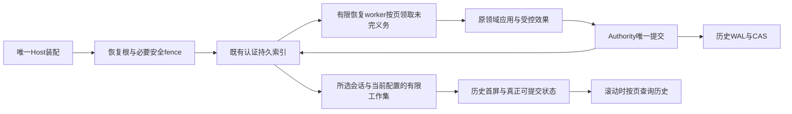

# 终端启动：累计状态边界与恢复架构

更新：2026-10-19。状态：**包0及包1a已通过整轮独立审查并提交发布；下一步按双方认可的执行计划完成交互长尾前置包，再进入调整后的1b与2。** 当前执行顺序以[终端迁移收尾方案与执行计划](../tasks/terminal-migration-delivery-plan.md)为准。B2/B3已通过单元审查，收窄C已通过总控正确性验收，C阶段G11/G17新增改造已回退。本文继续维护累计状态机制及技术边界。整个启动专项尚未最终验收，旧调度副本缺少绑定退出证明时继续pending，R2不再指导已替代机制。

本文是[启动性能专项](../tasks/terminal-startup-performance.md)的架构增补，唯一维护累计状态机制清单、目标结构和实施边界。耗时账与原始证据归[执行记录](../tasks/terminal-startup-performance-record.md)。母架构以[架构概述](../../research/design/architecture/overview.md)、[AE-001](../../research/design/architecture/evolutions/AE-001-companion-intelligence.md)和[分布式规格§4.1](../../research/design/modules/distributed-runtime/specification.md)为基础，不另造产品语义或事实权威。

## 1. 目标和边界

- 当前冷启动同条件重复样本**中位约5～7秒**，允许正常波动，更快也接受。V6候选8长历史5.86/6.45秒、热启1.60秒已经达标；单次15.27秒不据此判整版失败，不另设逐次7/8/10秒门槛。
- 独立的结构要求：增加已结束会话、运行、任务、过往许可版本与内部记录，不能让普通启动、打开会话、首发准备反复处理全部累计历史。不能以删除历史、降低验证、隐藏等待或新增业务数量上限解决。
- 范围限现有S/N/U/R、Host及其实际启动依赖，覆盖冷/热、初次配置、配置重启、升级、异常恢复、离线与现有角色拓扑。保留原功能/体验；不新增产品功能、通用数据库平台、第二恢复引擎，不重新优化整套UI。
- 审计基线为HEAD db91d03f加2026-10-15候选8的全部未提交生产源码。HEAD本身不等于审计对象。代码中的增长机制与实际增加多少秒分别举证，本轮未新增耗时实测。

H表示累计历史（含终态元数据），F表示本次启用功能的必要装配，K表示当前请求必需的有限身份查询，P表示首屏/上下文预算，D表示未耐久发布的恢复尾部。普通启动目标是**固定根元数据＋有界D＋K次索引定位＋P**，不包含遍历H。允许树深度、平台I/O与调度波动，不承诺数学上的绝对恒时。当前有效配置数量造成的必要功能成本与旧历史回扫分开。

分页返回但循环读完所有页、全量Map改名checkpoint、压缩blob或加MAC，都不自动满足这个目标。当前未完任务很多也应按页由有限worker处理；不能把整个待办队列全部放入普通启动栅栏。

## 2. 启动覆盖图

| 阶段 | 生产入口 | 核对责任 |
|---|---|---|
| T0 前台接管 | entry→terminal/launch→supervisor→R/U/N；instance-assets.ts:63 | 原生恢复写者、终端模式、实例资产与临时账本 |
| T1 配置/连接 | terminal/application.ts:662；serve/topology-command.ts；CoreHostConnection | 当前配置/秘密投影、Host发现、热连接与冷创建 |
| H0 拓扑/安全 | serve/application-host.ts:199→mesh-runtime-bootstrap.ts:82 | 单机/可信home、两种角色、设备生命周期fence |
| H1 权威装配 | serve/command.ts:738→setup-delivery.ts:570 | 双日志、资产恢复、权限目录、资源、workspace/exposure |
| H2 领域准备 | access-surfaces.ts:534/973；command.ts:1074/1274/1507 | 会话恢复发现、本机/远端执行、调度、工作场景、扩展/通道/投递 |
| H3 开放恢复 | command.ts的startAnchorRuntime/recoverAdvancementAcceptedWork；local-conversation-owner.ts:1063 | 必要安全栅栏与恢复消费者分开，不能等待无关历史工作全部执行 |
| N0 所选会话 | terminal/application.ts:713→conversation-resume-binding.ts→protocol-runtime.ts:2337 | 最新会话、当前运行/推进/确认、运行体和上下文 |
| N1 呈现/控制 | ConversationController、Timeline/BodyReader、DisplayStore | 首屏、历史外输入、中断目标、分页、离线兼容、首发 |
| X 停止/重启 | stop、Host逆序清理、checkpoint/flush回调 | 不把全量成本搬到退出；停止返回后无遗留写入 |

显式全量导出、用户请求的全历史查询、跨设备资料传输本身可以按资料量耗时，但不能暗中成为普通启动前置。这里只检查其调用的本地启动/恢复是否把已完成历史重新装入。

## 3. 机制清单

**G**：已证可达的累计增长机制；**C**：对应现有功能/恢复分支启用时可达，仍属实施范围；**B**：已具有边界或没有证据是历史增长，保留并回归，不凭可能性扩面。行号用于定位，工程实施以符号/调用关系为准。G/C待办不代表已经实测出新增超时。

### 3.1 物理层与投影

| ID/待办 | 入口、已证机制与增长源 | 目标处理 |
|---|---|---|
| G01 [x] | 原机制：core/authority/commit-log.ts:658整份readFile checkpoint；startup-proofs.ts:145/197整份serialize/deserialize。64MiB超限不保存，可能反复回放 | 2026-10-28包5-5e独审通过（候选c9ce9006）：会话分派的标量检查点已退役，状态由按键投影持久，旧检查点只一次性接续；派发账本绑定检查点只存本次请求批次，沿用时按派发领域索引从目标派发自身LSN键起判断其后有无新信封，不从全局旧游标扫描无关记录；decision-migration只读受信旧代次一次。见§4.15 |
| G02 [x] | 原机制：commit-log #scanAuthenticated→frame-index ensureRows/scanRows；按流过滤仍可从0遍历全部认证帧行，Bloom只省载荷 | 2026-10-28包5-5e独审通过（候选c9ce9006）：checkpoint生命周期与会话迁移冻结改由领域索引按键定位（§4.7边界、§4.15），恢复尾部沿§4.3既有帧数/字节准入。其余无游标全流读取（设备移除、配对恢复、计划迁居v1旧协议分支、灾备、本机退役、单分派spool）不在启动、普通回合或状态查询路径，按合同不改 |
| G03 [x] | 原机制：durableProjection读前追平、initialize失配重建、prepare/flush/compaction | 2026-10-28包5-5e独审通过（候选c9ce9006）：单次get/scan对每个增量段（≤5）一次二分加对数深度目录页，不随键数按比例增长、不重放日志；reset以同锁内已发布清单与进程内清单中较新者为基准，代次单调，见§4.15。会话打开时多次调用的累计读量、冷启动段整理固定成本与实际启动时延归包7同候选验收，本行不代表启动时延达标 |
| G04 [x] | 原机制：registerCheckpointFlush、saveProjectionCheckpoint、stopStorageMaintenance周期/退出保存 | 2026-10-28包5-5e独审通过（候选c9ce9006）：停止时只刷已准备且有未发布进度的投影（有界覆盖层），不打开未用索引、不重放历史、不做历史整理；登记的checkpointFlush均为DPI flushCheckpoint |
| B01 保持 | frame-index分页MAC；DPI #validatePublishedStorage校验固定delta边界与树根 | 保留按需历史页和现有认证，不改回每次整文件验证，不靠扩大缓存预算掩盖增长 |

### 3.2 会话与首屏

| ID/待办 | 入口、已证机制与增长源 | 目标处理 |
|---|---|---|
| G05 [x] | 原审计机制：ConversationRunJournal的commits/admittedByRun/stateByRun等随历史累积，v2仅去正文 | 2026-10-19包1a独审通过：当前/指定工作集与历史exact分离，同前缀决定，保存不再整体序列化历史；不代表最终整链延迟达标 |
| G06 [x] | 原审计机制：恢复发现保存、复制并遍历全会话/run/publish集合 | 2026-10-19包1a独审通过：同事务pending目录、当前fence、分页恢复及停止义务 |
| G07 [x] | 原审计机制：缺checkpoint时收集所选run及全局publish/final-outbox信封 | 2026-10-19包1a独审通过：按会话、assignment/frame定位和恢复；认证导入base与本地tail同边界，新旧资料、目标续执行及当前owner直接责任随§4.9验证 |
| G08 [ ] | owner-services/advancement/recovery-maintenance.ts:126→directory.list后逐会话恢复；Host及local owner启动调用 | 只发现有推进义务的会话，不枚举全部对话；保留原始任务接纳与副作用恢复 |
| G09 [ ] | ConversationMessageInputReader #prepare/#read先折叠本会话全消息事实、排序inputs再截200条；控制页从0追历史 | 历史外输入和可中断运行持久定位；当前控制与历史展示分开，页上限不能掩盖全量前置 |
| C10 [ ] | conversation/directory-reader.ts:7、repository.ts:136、N离线listPage；返回有限页但先遍历目录/meta | 本地持久活动目录/最新定位；离线不重新枚举全部历史，旧目录仅用于迁移 |
| G24 [ ] | build-startup-bootstrap.ts:90预算前调用snapshots.list；snapshot/store.ts:75读全部摘要并排序；shard/byte-reader.ts:54为最新/前驱分片遍历全目录；legacy计数也全扫 | 摘要资格索引、当前分片/前驱定位及可信计数；保留摘要不覆盖原文、clear和回退语义，见§4.6 |
| G25 [ ] | shard/store.ts:213 appendCommittedRun→findRunInLock:377首次建全runId Map并读全部分片；conversation-manager.ts:1689首轮结果/恢复可达 | runId到物理位置的耐久幂等投影；定位缺失与真实不存在分开，不能把全量成本转移到首轮提交 |
| B02 保持 | SessionMeta.turnCount与正文token预算本身有界，但不能证明其前置发现有界 | 保留正文装填/最近一组压缩核；修G24/G25，不再将正常bootstrap整体标作已有限 |
| B03 保持 | Timeline/BodyReader有界片段、N首屏每轮最多4片、display replay/page | 保留顺序、源身份、clear/delete代际、阅读锚、草稿、复制与原UI；仅显示页有限不证明底层发现有限 |

### 3.3 Host和执行域

| ID/待办 | 入口、已证机制与增长源 | 目标处理 |
|---|---|---|
| G11 [x] | DeviceLifecycleJournal 按键：startupState 精确读退休指针并只读 active 目录首项，state/latest/activeFor 精确读；mesh-runtime-bootstrap 只用 startupState。启动只恢复未终结的移除（active-kind 目录），读取与已终结移除数无关；operations() 只作显式历史查询。终态取回按请求解析：issuer 的成员入口与常驻中继注册只含当前 active 成员，历史设备只经固定数量的终态接入（直连监听 + 中继上当前/前一窗各 2 条）进入，SNI 携带由 issuer 终态路由秘密派生的不透明 operation 定位，按 removal-route 目录精确读出 operation 并核对代际与传输身份后才建该连接的 CA；入口用途绑定到连接，只开放该 operation 的终态 exact-set。传输对端目录按设备键存储，启动与信任变更只精确读当前成员，轮询稳态不读。target 侧在 accept 时落盘路由秘密与恢复制品，删钥后的本地终结与仍需联网的专用取回都在 bootstrap 普通装配之前完成；进程不重启时，不可逆之后中断的内联续做交给唯一的运行中取回 owner；路由副本先于本机 terminal 删除。issuer 的撤销与终结回执按撤销事件摘要经当前信任投影的摘要目录精确读原事件重建；首次撤销（含启动恢复 revocation-ready）在生命周期锁定前缀上精确读 operation、当前信任链头与 active 目录、祖先事件与目标设备的 active 凭据暴露，不重放 trust、exposure 与生命周期流；签名信任记录 v2 只列 active 成员，签名按 active 目录读、写入按同一目录与 active 计数全等核对，读取、物化、验证与写出随当前成员数，不随已撤销成员与已完成移除增长；历史成员与身份留在事件链和身份目录，按键给出；开发资料里 v1 快照是历史帧，值班设备补签、其他设备对齐取回同链头的 v2 一次性接续；取回与重投都不整读信任流、不重放生命周期流。取回 owner 停止时取消握手中与等待请求中的网络等待并回收连接。设备移除删除后的收束核对先等正在跑的一轮恢复结束，再在静止点上逐会话读取 | 2026-10-26包3独审通过（候选817203bb）：启动只恢复未终结的移除，读取与已终结移除数无关；同一issuer下终态自动取回；首次撤销与v2当前授权快照随当前成员数；冷重启后历史身份在验签边界内按需补齐。迁居/灾备与终态取回的交界归包5（C22），已声明失联的设备重新出现归包6，冷启动段整理与准备的固定成本归包5、时延与慢样本归包7；不代表最终整链延迟达标 |
| G12 [ ] | Anchor/ExecutorResourceGovernor #restoreCheckpoint/#compactProjection整体装载reservations/usage/lease/dequeue；27天保留仍随使用增长 | 类公平差额/当前占用聚合、指定lease等exact；历史usage和幂等索引落盘，TTL/时钟/公平重放保持 |
| G13 [ ] | DataPlaneTicketRegistry.recover:429/maintain/#load全票据；AssignmentLedger:1804绑定checkpoint整Map | ticket exact授权、expiry/未撤销义务索引；只为当前连接或待执行assignment恢复绑定 |
| G14 [ ] | listScheduleTaskIds:44保存所有出现过的taskId→AnchorScheduler.prepare:154逐task恢复定义/occurrence | 当前定义、下一到期、未完job目录；系统任务exact准备，历史任务不先装载 |
| C15 [ ] | listConversationTransferStates:710→LocalConversationOwner.start:1090全迁移Map、排序后筛选 | 当前active/fenced迁移按conversation/operation定位；终态幂等按键保留 |
| G16 [ ] | workspace-bindings.ts:906/938、workspace-probe.ts:533/557及setup-delivery:1060整投影加载/clone/保存 | 当前binding、未完操作目录与request exact；保留establishment marker、签名与版本水位 |
| G17 [x] | CredentialExposureAuthority 的路由与绑定按键读，待轮换走 compromised 状态索引；暴露索引另按（绑定，服务）聚合历来最大的修订号。启动轮换发布从待轮换记录起步，修订号精确读聚合后加一，publishRotation 只读回受影响记录与当前待轮换列表；读取随待轮换数，不扫描过往身份。startup-application 只读本机 SecretStore，不读暴露索引；过去 principal/scope 身份保留 | 2026-10-26包3独审通过（3-2，候选953d0e56）：启动轮换发布的读取随待轮换数，不扫描过往身份，修订号与原算法一致；待轮换列表的O(C²)重复读如实保留；不代表最终整链延迟达标 |
| C18 [ ] | ExtensionApplication.list:85冷恢复全extension流并返回全部operations；channels prepare/snapshot使用 | 当前实例/未终结操作目录；完成操作exact；按现有功能装配，不新增渠道生命周期 |
| C19 [x] | 原机制：AuthorityDeliveryPipeline.prepare→AuthorityDeliveryQueue.load→DeliveryAuthority全流/全列表再过滤pending | 2026-10-27包5-5b独审通过（候选86bd4238）：投递权威改为按键持久投影，入队在源事务里按键读，生命周期按条目号装入，准入分页冻结，排空每轮有上界、关闭即收束，计数读计数行，状态历史按主体补读与全局分页，当前uncertain有限分页；权限、回执、未知效果、幂等与补偿语义不变，见§4.12。普通冷开含有限的未发布尾部回放，最终时延归包7 |
| C20 [ ] | mesh-bootstrap-store.ts:178/193→mesh-runtime-bootstrap:93；受管启动/backup owner也调用，重复重放trust全事件链 | 认证的当前信任投影与版本/epoch；fresh授权仍查当前信任，历史链验证/scrub保留；覆盖startup-application的本机配置/安全端口 |
| C21 [x] | 原机制：FileTrustRuleSnapshotCatalog.open/#reload→loadPermissionSnapshotCatalog枚举全部保留快照 | 2026-10-27包5-5c独审通过（候选eef27b7f）：快照内容寻址，另有head、按版本、按规则内容与按发布位置四类小指针；只读当前及在途租约引用的旧快照，按原合同验签；head与指针带home完整性MAC，读时有界核对，合法版本跳号下回放旧head也拒绝，见§4.13 |
| C22 [x] | 原机制：可信home post-install的checkpoint/recovery activation、planned/disaster staging含整快照/目录恢复 | 2026-10-27包5-5c独审通过（候选eef27b7f）：当前安装与未完安装按键索引，正常已完成安装不回扫；迁居/灾备后终态取回与有效成员接续（路线A）见§4.13。checkpoint当前流读取与DPI整理放大归5e |
| G26 [x] | 原机制：setup-delivery.ts:675→surfaceAssets.recover→ArtifactLifecycleIndex.synchronize:311；while(more)排空多日志追尾和retirement/adoption/expiry/temporary；surface-asset-maintenance.ts:92停止时还新起整轮维护 | 2026-10-26包5-5a独审通过（候选44a25e91）：安全根/配额/引用证明与回收分开，跨日志向量和源端尾部预算在维护，见§4.8。DPI重建步骤不读盘等观察划入5e，5e已闭合（reset代次单调，见§4.15） |
| C27 [x] | 原机制：command.ts:1274→worksceneDirectory.recover→global-state-adapter.ts:251，启动循环全部pendingDeletionPage并逐项projectDeletion | 2026-10-26包5-5a独审通过（候选44a25e91）：保留已有pending索引，受影响场景删除fence先可见，清理按页续做，不排空全部待办才ready，见§4.8 |
| B04 保持 | ChannelInteractionCoordinator.listOpen是当前内存开放relay；executor job恢复有有限页 | 修上游全量发现，不把已有限的消费者再造一遍；开放义务多也不能全量阻塞终端ready |

### 3.4 旁路与排除的误报

| ID/待办 | 已核观察与边界 |
|---|---|
| C23 [x] | 原机制：LocalLogStore 每个写步骤清点受管根与全部历史日志目录（两次全量 stat），历史文件总数超 4096 即整体拒绝 | 2026-10-27包5-5d独审通过（候选ce0da48f）：普通步骤只清点受管根；历史发现沿原生续读每步有界、重启从头有限重扫、幂等接续；登记表受 maxFiles/governanceBytes；未发现的不计入、发现走完才确认，见§4.14 |
| B05 保持 | TerminalInstanceAssets以rootInstances/rootBytes和目录批次管理临时资产，未知PID/birth保护不能删。其有限活跃实例不是无限对话历史 |
| B06 条件核对 | VaultSecretStore.readPayload确实整库解密，但尚无证据证明废弃秘密历史常规累积；当前有效配置数量属F。只在实证历史累积后修相关读取，不凭可能性设计新秘密存储，更不得读出用户秘密验证 |
| B07 保持 | 模块加载、原生R、OS解锁、当前Provider/MCP能力装配属于固定/功能成本，保留已有lazy import与预拉起；不借本轮更换UI框架 |
| B08 保持 | 用户明确请求全量导出/历史搜索、跨设备资料传输、全部可信恢复材料丢失后的真正灾备允许按工作量推进，但不得暗绑普通启动，正常升级不得冒充灾备排除 |

覆盖方法：枚举所有生产loadProjectionCheckpoint使用方（run四投影、发现、生命周期、双governor、executor绑定、workspace双目录、task IDs、transfer），再沿T0–X真实调用链补查非checkpoint整流/目录/数组/clone与分页前置。G/C必须有实现或新的边界证据才能销项；B仅保留必要回归。不能因“以前通过”“名字叫缓存”排除。

## 4. 统一目标结构

### 4.1 三类状态，一个事实来源

1. **权威历史与原始制品**：现有WAL/CAS，保留完整事实、历史和证据，不删历史、不新增双写权威。
2. **可寻址当前状态与义务**：统一用现有DurableProjectionIndex。领域owner定义codec、主键、二级定位、pending谓词和版本；当前状态按键/有限页读取，终态幂等与历史驻磁盘。
3. **进程工作集**：仅当前选择、有限候选与事务确实触及的状态；淘汰后exact重取。标量checkpoint只装固定schema字段、水位和根引用，不承载随H增长的大Map/数组。

这不是全部延后到后台。全局安全fence、当前根完整性、资源占用裁决及所选会话必要状态先完成；已完成历史、无关积压和回收不进入相同等待链。

### 4.2 领域查询合同与保留语义

逻辑目录可以只是已有索引的前缀，不要求逐项新增包/类/数据库。

| owner | 首屏/首发所需查询 | 历史驻盘内容 | 一起保留的责任 |
|---|---|---|---|
| Conversation | current-session、active-run、queue-head、run/assignment exact、pending by conversation；摘要资格/分片前驱/转录位置 | 历史commits/admissions/terminal、publish/final、摘要与分片 | ingress幂等、cancel/uncertain、clear代际、revision、当前输入与全部未完副作用、首轮转录不重复 |
| Recovery/Advancement | pending by domain/conversation及页游标 | 全会话/全run/已完推进历史 | 原始任务接纳、settlement、未知效果不得自动重做 |
| Resource | 类公平差额、当前占用聚合、lease/reservation/usage exact | 旧租约/usage/幂等tombstone | 原27天保留、TTL/单调前沿、精确重放、公平与不超额 |
| Lifecycle/Transfer | subject gate、active operation、最后终结水位、operation exact | 所有启停/迁居历史 | 退休身份不复活、fence优先、未完动作恢复 |
| Schedule/Delivery/Extensions | 当前定义/启用实例、到期/pending页、request exact | 历史task/occurrence/已完操作和投递 | 原触发时间/补偿/回执、幂等、uncertain与待确认隔离 |
| Workspace/Exposure/Trust | 当前binding/credential身份/信任epoch、必要旧版本exact | 旧探针/秘密暴露身份/权限快照/信任事件 | 目录建立证明、签名与撤销、合法旧任务证据 |
| Asset生命周期 / Workscene删除 | 多源当前引用/占用与grant exact、released候选页；scene删除fence与pending页 | 旧grant/release/接管历史、已完删除 | 跨源零引用复核、保守保留、配额不低估；删除事实先于隐藏及幂等物理清理 |

N/U仍只消费有限领域DTO，不直接查询内部索引或建立第二状态机。固定投影定义在首次写入前登记；事务通过已有readProjectionIds等有限端口在同一已验head读取全部决定依赖。写入仍维护候选信封的相关投影，不把读取声明当作全部写影响；不强制引入新的依赖框架或每会话物理根。禁止用“懒Map”包装后让原业务for-of重新读完全部历史；需要遍历的产品行为明确scan/continuation和预算。

同一个request/run/assignment/operation的精确重放必须能找到历史terminal/拒绝/撤销事实；新目录只改变访问形态，不能因它离开活跃集合而再次接纳。关联确认、输入归属、内容资产引用与回收保护随原事实保留。

查询必须区分“已证明不存在”“尚未加载/未覆盖”“来源失配/不可用”；只有在当前已验前缀上完成exact定位或完整范围证明才能返回不存在。不得把未加载Map键当作新请求，或把第一页为空当作没有未完义务。写事务声明并取得它所需的完整有限读集合，缺任何必要项都不执行决定；跨键约束由同事务维护的聚合/二级键证明，不扫描历史补齐。每个迁移的原reducer不变量必须映射到明确读键及更新键，保留同前缀验证和CAS，不能只机械替换容器。

离线读取继续经既有本机只读应用端口；新的本地活动目录由领域投影维护并携带代际/clear-delete边界，N不得自行读取或修改Authority/DPI。无合法离线目录时以现有可恢复状态接续迁移，不能把未知代际旧视图作为新事实。物理分页/字节预算复用现有边界，不能为满足计时新增用户业务数量限制。

C10的会话meta文件仍是其本地目录事实，不承接领域权限或推进义务。主派生目录可读时，普通只读查询复用一致的已发布有序视图，并将未完成耐久intent目标的真实meta纳入该次排序/筛选/分页；绑定真实发布修订，不靠根mtime判断新鲜度，不维护随每次更新全量重建的持久私有目录。主缓存完全不可读时按事实故障降级，不能跨调用信任旧缓存，也不将异常扫描当正常有界证明；源权限失败如实报错。写者不能记耐久intent时在meta修改前失败，不静默破坏读取协议。所有派生物理定位在任何reader调用前统一校验，读后绑定业务身份；普通文件目录不另建MAC平台。

### 4.3 原子更新、尾部界限和停止

保留规格§4.1“准备→唯一WAL fsync→不可失败内存发布”。同组主记录、pending二级键和聚合尽量放在一个DPI内共同准备、发布；跨投影决定在同一日志锁下追到同head。不能提交后再补做可能失败的领域决定。跨日志资产责任仍见§4.8。

候选重建可以在既定帧/字节/内存预算内采用批内工作集，逐条执行同一归约和guard、观察本批前序状态，仅合并待发布的同键派生输出。批次完整物理计划须覆盖真实occupancy和I/O quantum，保持源锁与容量准入顺序，不以physical上下文绕过计量。批末耐久checkpoint之前不声明已完成，失败/取消回到已耐久边界；不得跳过非法中间事实或把全局未知当不存在。执行方式变更先以同源同head的状态、拒绝/恢复语义和全成本差分验证，不因此改变相关写必须取得完整可信状态的合同。

- 每个生产读写入口在首次写入前登记该日志固定的全部领域投影定义，不能只覆盖Host。定义只依赖home级端口，不因登记启动模型/MCP，也不为历史会话逐个实例化。首次写入前追平健康但落后的固定投影，多个投影共享有界尾部读取；登记不等于已同步。新建候选与故障投影按依赖隔离，不能借全体同步阻塞无关写入。尚未访问的健康投影也必须随写入推进，不能跨实例累计全部历史。
- 健康且已追平的投影在日志锁内对本次信封归约；确认无相关输入时只在内存推进检查点。允许O(功能投影数)，不无理由执行无关业务归约，不逐次把全部清单写盘。未覆盖/失败投影不能跨过未知相关事实。
- Kf/Kb分别为帧数和物理字节的硬准入上限，Rf/Rb为更低的主动刷新阈值；按源帧尾偏移计欠账，保留覆盖层条目/字节预算。认证帧索引未封存的行也计入必需恢复尾部；定时器仅辅助。
- 在权威追加之前检查“当前欠账＋本次已准备追加量”。超硬界先刷新既有欠账，失败在追加前背压；不能先越界再挡下一次。单个既有合法帧超过Kb时，只能在零欠账时接纳；异常退出物理尾部上限为max(Kb, 最大合法物理帧)，最大物理帧由帧头、载荷上限、相应格式帧尾的常量计算，测试与实现复用同一计算。既有整批导入/安装属于独立重建路径，不新增业务限制。阈值依据物理预算，不随H增长。
- 已fsync成功的提交不能因随后检查点失败变成“未提交”。尾部上界只对所有生产入口遵守准入的健康日志成立；新索引初建、确实损坏/换钥重建、旧二进制随后写入的新增尾部分别计量，不能借例外掩盖入口漏接。
- 停止收束已开始原子步、发布已有有界覆盖层，不打开未用索引、不序列化全部终态、不新起整轮维护。取消和共享等待者沿现有runner处理。
- 失败不污染已验证基线。由不可变归约、显式按需副本或事务私有草稿提供隔离；不在底层默认复制整份状态，也不因取消默认复制而共享可变候选。

### 4.4 开放规则与故障隔离

Host.ready仍要求必要身份、全局fence、当前资源和产品入口成立。Terminal.usable还要求所选会话的元信息、预算内上下文、首屏、控制和运行体准备完成。两者分别计量，不能用输入框已出现作为真实可用。

Host组合层分别声明两种就绪边界的必要投影集，显式准备，不依赖启动恰好发生写入或制造一次写入。按每本日志记录(logId, LSN, frameEndOffset)就绪位置；首发不得补做该边界之前的启动欠账或必要初建，但允许同步就绪后新增的事实。真实损坏恢复单独分类。其他新投影分页构建，依赖它的读和触及其输入的新写在可用前不得执行决定。

恢复先读可信根与必要scope安全状态，有限worker分页领取未完义务。恢复总工作量可随真实未完义务数增加，但历史终态不参与；不能要求无关旧工作全部执行完才开放终端。选择一个待确认/有未完效果的会话时按原产品语义呈现，不假装能执行，也不重复派发。

设备退休、全局权限/迁移fence未知时不开放相应业务；普通历史积压不能被升级为全局fence。安全根未知或损坏不得“先用后验”。

### 4.5 完整性、授权、密钥与入口

认证manifest、页和条目绑定projectionId、显式reducer版本、日志身份/前缀、物理键和业务身份，读取后继续验证key/identity全等。fresh授权检查当前主体、scope、trust epoch、TTL和撤销；历史事实的已验派生状态不表示旧凭证现在仍有效。

包1b按实际生产依赖将G08待办目录及canonical当前运行状态共同纳入现有认证机制。保护完整折叠状态、当前性及存在/不存在结论；未经认证定位器加单条来源/身份核对不足以保护删行或同身份旧状态。未认证旧页必须由owner从已认证事实重新推导，不能直接补MAC，初建与接续成本随本包升级验收，不重建无关投影。复用已验状态不能取消新提交的业务guard、原始流及候选信封校验。

每个home的缓存完整性密钥沿现有保险库跨进程锁原子get-or-create，仅缺失时创建，不能以分开的get/put/get制造并发换钥。它与业务身份密钥分开，不参与解释WAL格式或权威事实。生产日志组合入口取得密钥并按实例注入，取消进程全局后台加载及超时后永久选模式；复用已解锁保险库，沿现有平台后端，不把无系统钥匙串当作无保险库。

同Host同物理日志共享一个有明确生命周期owner的实例；其他进程仍可能写入，文件/清单变更仍需验证，不能缓存外部状态直到退出。工具、备份、配对、离线配置等实际打开日志的入口均在B2核对归属与固定定义登记。

统一入口分两阶段：先登记能够自校验信任链的当前信任投影，取得当前必要信任状态；再组合制品库与活验签器，登记其他固定定义。当前链头、纪元、签发者、活跃成员按当前规模读取；历次登记/撤销/换钥身份持久按键保存，只有需要验证历史事实时精确读取，不在普通启动装入全部历史身份或重复扫描trust流。显式整链审计保留。C20的这部分启动信任准备归B2，其余本机端口与领域工作归C。

ProtocolSignatureVerifier.verify保持同步。home进程内缓存已验证的公开身份，按现有keyId规则查找；不存在/不受信结果不缓存，已缓存公钥不得被同键另一身份静默替换，缓存不替代当前授权裁决。缺失身份以专用“尚未加载”信号返回，由已持有日志边界的异步解析端口在同一已验位置精确读取后重跑该未提交步骤；找不到则沿用不受信错误。覆盖投影归约、尾部与候选页、事务/读取回放及纯决定；每个步骤的同一缺键只补齐一次，未提交草稿从正确起点重建，不重跑已完成副作用，不再次进入同一非重入日志锁。缓存绑定本home/信任来源，日志替换或身份来源变化不得误用旧来源条目；同信封采用提交前信任状态的现有规则必须保持。日志边界外的验签按实际入口分类，必要时在既有异步入口补齐；不引入无校验占位。首次配置、配对及建立本机身份维持原产品顺序。

只读入口在已验事实/投影上做单次exact或有限读取。无密钥时只在内存严格重建，不清空或覆盖认证目录、不修剪WAL、不创建权威文件，也不能把暂时无钥返回为空状态；生产可用前取得原安全合同要求的凭据。startup-application的trust/exposure guard归C20/G17，经既有本机配置/安全应用端口取得有限状态，离线首配不依赖尚未启动的Host。

派生损坏由唯一恢复边界按页重建并保存进度，权威损坏拒绝。I/O错误不能一律当缓存不存在，认证失效不能降验证；失败/取消丢弃未提交候选，保留正确基线。

### 4.6 正常bootstrap与首轮转录投影

G24/G25由会话存储投影负责，保持当前预算、摘要文本与原文选择规则，不让N理解分片文件。

- **分片与run位置**：把整份`index.shards`和首用全runId Map替换为持久的当前分片根、分片前驱定位、runId exact位置。位置绑定conversation、clear边界、runIndex、分片身份、字节范围和内容摘要；冲突仍比较已提交规范记录，不能只比较runId。首轮结果投影不读其他旧run正文。
- **摘要资格**：查询语义严格为“`coveredThroughRunIndex < earliestLoadedRunIndex`中的最大`createdAt`，且晚于lastClearAt”；新摘要与原文重叠时必须能选到更旧的合法摘要。仅取最新文件、先列全摘要再过滤都不成立。实现是快照目录内按会话的专用索引（两半交替发布的固定根加定长项分段），仍是派生缓存，不升级为业务权威，也不放进DPI——DPI的源与归约绑定CommitEnvelope与源checkpoint，摘要不是WAL事实。正常写入路径上覆盖边界随创建顺序严格递增（窗口配对只来自新追加的run，折叠只取配对前缀，打开、clear与视图重建后窗口没有配对）；写入方只登记createdAt与coverage两维都严格递增的快照：coverage不前进报锚点不变量异常并停写该会话，墙钟回拨或同一毫秒的新项被已登记的较新项支配、不写。于是查询就是在可见区间上二分“coverage < E的最后一项”，只读根、对数个定长项与命中的一份正文，并核对正文与登记项一致、摘要结构可渲染（对象，facts/state/active均为字符串）。启动只经这条只读选取：不持锁，不等写者的恢复、修复或转换，不写盘，摘要侧任何错误只降级为不带摘要；转录本身的错误照常报出。摘要存在性计数用于原有summaryReserve规则（登记存在不保证正文此刻可读，读不出时保守降级）；保留既有截断语义，命中正文缺失或损坏时按固定次数向更早的已登记项降级。
- **写入和恢复**：WAL已提交的run/clear仍是唯一业务事实。转录写者在现有会话投影锁内先记录本次有限物化意图及源checkpoint，持久写分片后发布位置、前驱、计数与已物化水位；确认投影完成前不得接受另一个可能跨越该尾部的物化。崩溃仅核对意图指向的有界尾部，按同run/同载荷补索引或完成原追加，不能因索引暂缺再追加一份。真正丢失持久目录按§6恢复，不每次首发重扫全部分片。
- **摘要及保留清理**：SnapshotStore新文件仍是派生摘要缓存，不能把它虚称为已有WAL事实。登记先写第count个定长项作为有界待登记标记，再经由该标记确定的临时落点写正文并改名，最后发布根；任一步失败在本次调用内重读根收束，恢复只看第count项，删除残留之后才清零标记，删除失败时标记保留、下次续做。clear不改索引，查询按lastClearAt判退役；retention按createdAt前缀先撤可见，再按续做位置删除正文，段内全部正文删除后整段回收定长项。摘要损坏可按既有合同降级，不得将任意数量坏候选的同步遍历变成新的启动扫描：当前索引缺失或损坏时前台不带摘要、只读入口不写盘，修复（由快照文件重建）只在保留期维护中进行；早期本地测试资料（只有快照文件）由维护一次性按支配链建立索引，转换之前不在登记路径上转换、也不登记。维护已排队或进行中时，登记直接跳过，不排在可能随历史增长的维护之后。

这些步骤是同一转录/摘要投影的耐久收尾，不产生第二业务日志或更改对话语义。离线读取只能消费已发布的自洽目录与其clear/delete代际。固定正文预算而增加旧摘要、旧分片、旧run时，发现、命中正文读取、首次幂等物化都须有边界。

### 4.7 固定领域投影、输入过滤和同前缀决定

在现有AuthorityCommitLog/DPI中登记固定领域定义，以领域索引里的会话前缀定位，不新增源位置目录、写者版本登记、持久迁移门、全局激活指针或强制每会话物理根。这里禁止的是额外的跨领域全局源位置设施及其写者/迁移协议；领域索引为本领域定位保存必要的原记录位置（例如会话迁移冻结按会话找到需导出记录所在的信封）不在禁止之列。

1. 领域声明消费的stream/记录类型并使用严格codec。无关输入不执行无必要归约，公共负向测试证明输入声明不会漏掉相关事实。未知类型/归属不能静默跳过。
2. 同一事务的全部有限读取与相关写投影在日志锁下追平到同一已验head，然后准备delta、一次WAL fsync、不可失败发布。候选新增依赖时在提交前补齐并重新决定；未覆盖键不能返回“不存在”。
3. 健康已追平投影逐次在内存推进，连同认证帧封条遵守§4.3的Kf/Kb及原覆盖层预算。恢复读取有界尾部，不能每次从0遍历累计历史；该职责由固定入口登记与写前准入承担，不靠额外源目录。
4. 故障投影的相关读写安全拒绝，其检查点停在最后正确位置；无关写可继续。候选按§6有界页恢复，不能因失败永久从头扫描。共享物理日志/全局安全根不可验证时按真实依赖扩大拒绝范围，不虚构逐会话隔离。

物理读取、段删除和清单发布服从同一日志锁及资源责任，跨进程读者保护见§6。

### 4.8 资产多源恢复与工作场景删除

**资产不假装是单日志原子投影。** ArtifactLifecycleIndex继续消费本设备既有authority/executor等源，按`logId→checkpoint`向量发布同一代。每个源的引用/接管/撤销贡献在自己的WAL提交中成立；跨源集合按既定单调合并/规范源序收敛。单一索引协调者以generation CAS发布推进，不能用一个源的旧快照覆盖其他源新水位。

- **尾部准入**：源端记录已提交与生命周期索引已覆盖的工作量，按现有条数/字节预算预留本次贡献；超预算在相关新写前背压。预留/等待不持源WAL写锁，取得后重新核对head和额度。启动源根与未覆盖尾部恢复也受相同预算；不能仅靠“通常有空闲维护”假定D有限。源端当前贡献/聚合由同源认证投影维护，后台负责多源合并和物理清理。
- **安全开放**：启动恢复当前grant/时间前沿、可验证的配额/引用基线和有限尾部，不排空全部expiry、retirement、adoption、temporary清理。新上传/资产写准入须基于同一有效源向量的当前占用，或基线加有界未消费贡献得到的保守上界；不能漏算占用、把未知引用当零。无此证明时只阻止依赖该证明的操作；若首条输入确实依赖它，就必须计入真正可用时间，不能把等待藏到发送后。
- **回收与权限分开**：过期/退休授权依原耐久fence与时间前沿立即拒绝，延迟物理回收不续授权。GC仍按规格§4.2查有限released候选，并在ArtifactStore删除锁内复核跨日志零引用与当前pins；源向量已变化则释放锁，在锁外追平后重试，锁内不回放。不能因为一份索引较旧就释放内容叶/重放依赖，也不能把跨源重复贡献双计成永久占用。
- **停止**：不再新发起synchronize→整轮compaction。拒新、取消worker、收束已开始的原子步、发布已有有界覆盖层和源向量；未完成清理游标留给后续有限worker。需要新重建的冷索引不在退出时打开。源端准入的尾部预算使异常退出和无空闲时间的连续使用也成立。

**场景删除已有pending索引，修的是等待边界。** Workscene删除事实提交时，同事务发布scene级tombstone；绑定该scene的会话在当前查询/准入时按exact关系继承原有删除约束，不能逐个改写全部历史会话才建立fence，也不扩大原删除语义。目录与入口从该事实派生，不能等物理清理完成才隐藏。启动先开放安全投影，worker分页调用原projectDeletion；其内部contributions/removeScene也按有界批接续，避免“外层一页、一个场景内部全装”。只有所选范围依赖未完投影时等待相应范围。清理证明齐全后才移除pending，重试保持幂等；无关场景不等待全部删除完成，不新增“失败主页”。

### 4.9 会话收编基线与本地尾部（包1a直接依赖）

依据分布式执行规格§6.3及SourceFreezeProof、ConversationTransferManifest、ConversationTransferCommit合同，2026-10-17总控与战略架构师明确：**收编接收的是经源端认证的会话域基线，不是本地WAL前缀。** 本节关闭G05/G07与C15的直接交界，不前置C21权限快照、整个跨端模块或新迁移平台。

- **两类验证分开，产品语义共用。** 源端在自己的权威域完成提交原子性与资源/效果验证，冻结证明绑定其导出和源代际；目标验证签名链及全部关联、流计数/摘要/边界、内容引用和会话域自洽。导入归约保持身份、顺序、幂等、clear/delete、终态/裁决、control配对及sessionState与记录一致等要求，优先复用领域纯规则。本地提交的完整校验不放宽，不能加入调用方自报trusted或通用跳过校验开关。
- **来源位置不冒充目标提交。** 导入事实按manifest及源设备/ownerEpoch/transferId定位，保留sourceLsn与内容关联；新导出按需要保留原提交摘要及条目序号供精确溯源，旧格式仍以已签清单和流摘要绑定。不把过滤后记录拼成普通CommitEnvelope复算原摘要，也不将原摘要贴在不匹配的载荷上。导入历史定位不授予旧assignment重新执行的权利；当前ownerEpoch、授权、迟到提交及激活证明仍按原合同拒绝旧权威。所有来源位置均须反绑会话与清单，不能仅凭一个LSN或assignmentId接受记录。
- **不复制源端效果。** 会话收编不在目标重放源设备资源扣费或锚点已处理的投递。历史伴随缺失不能直接等同会话事实缺失；接续的仅为原合同明确要求的新owner义务，身份与幂等保持。源端冻结的闭包必须成立，不能把仍在执行的任务以已冻结基线导入。支持路径与通道测试的可达性分别核实，不能为反例新增原本不支持的收编入口。
- **索引种子保持派生性质。** imported阶段完成全部可失败校验，并按有界页构建与已签基线绑定的当前/exact/pending种子；沿现有预备、耐久提交、不可失败发布机制，使committed-base与其可用视图一次生效。种子不是第二事实源，不向权威日志写整个派生大集合；种子失效可从已认证资料恢复。当前决定绑定基线代际和本地尾部同一已验位置，历史exact按来源定位。普通启动/首发不全量加载基线，不能把解析整个records数组藏在打开索引之前。
- **旧格式离线兼容以资料充分为条件。** 对签名、清单、会话记录及必要资产完整的旧转移，在本地一次性校验/转换，允许取消续做、单列首开成本，正常二开有界；不能仅因没有governor/delivery伴随而要求回源。新资料与旧资料使用同一会话语义，不长期维护全量回放兜底。真正缺失/损坏的会话事实必须显式报错：未commit沿既有中止/恢复源owner合同处理；已commit不回退epoch，保留可验证的独立读取/操作，只拒绝依赖缺失事实的决定。若核心身份或安全状态不可证，相关会话的新写也必须拒绝；不能笼统承诺任何损坏情况下都可续聊，也不连带阻塞无依赖的其他会话。正常旧资料能力不得降级。
- **计划迁居是另一种来源。** 计划迁居安装的是完整源提交信封与目标installation/尾部，保持原LSN和摘要，沿完整WAL校验，不套用过滤后的会话基线规则。1a必须验证这种home上索引初建及后续普通恢复、已收编会话再经迁居仍正确；不改造计划迁居产品合同。
- **迁居后的当前权威。** 收编历史目标不是永久owner。会话代际按已认证收编基点及后续anchor代际差值派生；远端当前性由已验信任链派生的锚点任期与签名绑定证明，不由DeviceKey签名或观察高水位单独证明。唯一合同见[分布式执行规格§6.3.1](../../research/design/modules/distributed-runtime/specification.md)。同包完成共享解析、旧资料兼容、源/目标/执行端消费及有界索引，不前置新的同步平台，也不把单机启动改成必须联网。

完成证明包括正常本地域生产收编的新旧资料导入、commit、重启、续聊、重复ingress、旧assignment拒绝、未commit中止与已commit缺证隔离；收编后再迁居的来源连续性；本机与导入两类路径的历史规模工作量对照。现有本机负向校验保持。实现细节由工程师自主选择，整个1a独立验收前不把本节设计共识标成产品完成。

### 4.10 历史外输入与控制恢复（G09）

G09由会话读目录负责：首屏需要的“历史之外的输入”和“控制事实”都按当前义务直接定位，读取量与已结束历史无关。

- **历史外输入**：读目录为每条输入登记候选行，按来源分段（导入基底在前、本地在后），普通候选按位置倒序，uncertain运行的候选另成一段按位置升序。所属运行已提交且该输入已消费时删除候选。消费判定沿用投递事实的同一规则（进入过running、开启/关闭输入、提交或已观察到开始的首条输入，以及显式消费的追加输入）。读取分别取uncertain段与最近段，再按原规则合并：uncertain优先（多于200条取位置最早的200条），其余名额给最近的其他输入，按位置排序，截断与否由是否还有候选判定；有效性与clear/delete可见性先于名额判定。只有接纳时带了消息身份的输入在列表里给出身份，较早只有ingressId的接纳不补身份（按消息id查询仍可用ingressId定位）。输入键在基底与本地之间唯一（运行状态重放拒绝重复接纳），同键只取一份仅作防御。
- **导入基底的当前集合**：基底冻结时只允许排队这一种未结束状态，会随目标端本地事实变化的只有这些排队运行的行（首条输入候选、当前集合行、可中断候选及其索引）。基底推导时这些行直接写在种子区，运行在基底里走到终态时当前集合行与可中断候选删除、留下的历史外候选转进永不变化的前缀，准备末尾不做成批移动；收编提交归约进读目录时种子区播种进本地，此后与本地运行一样在本地维护、完成时真实删除。基底里只剩永不变化的行，导入段的读取由本地与基底各扫一页按键合并，不经过遮蔽，读取量与已完成的运行数无关；本地clear后导入段整体不读。
- **控制页的边界**：历史首页冻结本地head并给出完整checkpoint；控制页首页带上它，服务端用日志校验该checkpoint，再从这里起步。边界之后发生clear，或导入基底的激活点晚于边界（或已换基底），这份历史已过期，返回重置并重新取历史，不跳过新来源。
- **当前集合**：读目录为未结束的运行（queued、dispatched、running、cancel-requested、uncertain）维护当前集合行，键按来源分段、段内按当前状态记录的位置与条目序号，与扫描日志的顺序一致；状态变化时移动，结束时删除；行里记着该状态记录的修订。控制页先按32条一页补发边界之前（含基底）仍未结束的运行各一次，只有读到的状态仍是行里那一修订才补发，已变化的（新状态在边界之后）交给尾部；再从边界扫描其后的控制事实，两段共用同一游标与页预算，失败时不前移消费位置。
- **本进程义务**：边界之前已结束的运行由历史展示覆盖，不再下发；其中仍归本进程处理的运行——本地等待中的回合、尚未结算的旁观运行，以及完成链里未关闭的过程展示——由客户端经按运行的精确端口补齐：每次至多32个，只返回边界之前、已不在当前集合里且修订与位置一致的终态和已提交的final，每项带源顺序键（来源段、位置、条目序号）。客户端跨批按顺序键排好，与控制页当前集合段（同样带顺序键）流式合并，当前集合段读完后再接尾部，交给与扫描事实相同的消费者，可见通知的先后与日志一致。等待落定、待执行控制、当前任务、过程投影结束等副作用因此恰好执行一次；没有承接方的已结束历史运行不再产生终态通知。
- **本地回合的显示归属**：完成链结束等待后，运行的显示仍归该本地回合，直到恢复链消费完它的终态（已提交的final，或非uncertain的终止状态）再回收。归属不按数量逐出；恢复长期落后、未完成的归属超过512条时，改为从历史重建显示。

### 4.11 资源、调度与执行状态（G12/G13/G14/C15）

这四类状态都改成按键持久投影：同一份领域归约在提交时把结果逐条落键，启动、第一次活动与后续决定按需读取当前义务与精确主体，读取量与已结束历史无关。归约规则不复制，旧的整份内存投影与检查点不再保留。

- **资源调控（G12）**：调控记录由 resource-governor-index-v1 归约，预留、用量、用量预留、序号、排队与出队各自成行，另有按 workload 的活跃根、子预留、按预留与按根的未结用量、按根的用量块等二级索引页。工作集按键装入，读到未装入的键报待装入，由日志锁内的视图（事务与归约）或锁外的成批读取（同步判断）补齐后在新的复制上重做，从不把缺载当不存在；整封信封先按记录内容可静态得出的键成批预装，再一次应用。出队、释放、子预留闭包、占用聚合与非队首出队都走索引页，公平游标与差额是一行。保留前沿由信封时间派生（减去 27 天并向下取整到分钟，只前进不后退），终态根过前沿即逻辑不可见；依附在根上的行按根摘要判定可见性，同名根换代后旧行不会复活。按根定位的行（根下预留、根下用量、用量块）的键带根代际，清理旧一代只扫旧一代的键，主行另按根摘要核对，新一代的行与定位不受影响。物理清理按终结时间索引分步进行，每步有行数上限，巨型根分多步，进度就是尚未删除的行；启动与前台决定不等清理。会话在没有别的调控信封（按持久头位置判断）且工作集不足 4096 键时复用。分配能力的激活与撤销由 resource-capability-activation-v1 按（流、派发、执行方、预留）精确读取，不再读整条会话/作业流。停止与设备移除的收束核对经活跃目录读取本机仍占着的预留，不取整份调控快照。
- **数据面票据（G13）**：票据登记表按票据精确授权，到期与未撤销义务各有目录，只为当前连接或待执行派发恢复绑定。退休前沿的位置是“保留期 + 票据”，每步至多剪除 32 张（同一保留期的大批票据分多步），归约只核对并剪除这一批；启动恢复、签发与撤销只做有效性判断：授权按单调截止即时判定，过期即拒并单张退休；恢复只从到期索引里“现在”之后起读有效票据。过期积压的退休、资格撤销与已退休历史的剪除都由周期维护按批预算分轮续做（过期退休每轮至多 8 批、每批 32 张、一笔事务，候选取到期索引截至“现在”的一页），不在前台排空。票据域的全部时间判断（接纳预检、锁内接纳时刻、过期、恢复筛选、保留期起点）都用分布式规格 §1.1 的不可回退有效时钟：max(本地墙钟, 锚定 + 单调流逝, 日志时间前沿)。时间前沿由归约从接纳时刻、恢复记下的观测时刻与退休前沿取最晚，每次读写在锁内同一位置读取；跨端仍按签发者 issuedAt/TTL 与偏差窗换算。过期判定为“有效时刻 ≥ 接纳时刻 + 有效期”，不另存单调截止。退休前沿的推进只用落盘证据（交易时间与时间前沿取晚者），与归约校验同口径。恢复确实按某一时刻排除了过期票据时，在前沿流上记一条观测时刻（固定一行）。墙钟先前跳再回拨、或回拨后冷重开，被跳过的过期票据与迟到的旧票据都不会被放行；按有效时间合法签发的新票据热用与冷重开一致。读取在读够一页后交还续读，不留读视图。进程内的撤销标记只承担“物理效果已成功、完成回执尚未耐久”的窗口，回执耐久后即淘汰，之后的幂等由退休行的 revocation 与未撤销目录承担；签发与撤销不再核对全部已完成撤销。执行端租约时钟由 executor-lease-clock-v1 按执行端维护当前前沿，两条跨派发的规则在写入时校验：时钟只前进；启用生效时间写法之后不再接受旧写法。决定时按同一位置读出当前前沿。
- **派发账本（G13）**：领域索引 executor-assignment-ledger-v1 按派发键存两样：触及该派发的提交信封（原样，账本归约要核对同一提交里的调控与时钟伴随记录），以及按共享校验状态机推进的校验状态。另有对话恢复候选目录，口径是三个恢复查询（已封存；已接收且未取消；带票据取消、owner 尚未耐久处理取消证明且仍在接收、运行或已停止）的并集，作业派发由作业恢复索引承担。对话与作业同一口径退休票据取消：owner 的取消证明提交只在耐久处理了同一份证明时成功返回，执行端随即写 cancel-proof-owner-accepted 退休本地重提义务（恢复链与本地提交链都写）；超时、断连与未知保持待重提，owner 已处理而本地未落记录时重提按耐久重放幂等完成。运行、交互、资源与待定义务仍由 owner 侧各自的耐久目录承担。冷实例读写一个派发时，从索引读出它自己的信封，用账本的同一份归约重放，再从索引所在的位置按流续读此后的记录，不再按流从日志起点扫描帧索引；绑定批量恢复每次在索引上读 64 个派发。启动恢复只遍历候选目录，再按原条件逐个核对。索引不拒绝写入：记录校验不过的派发标为损坏并留在候选目录里，恢复照旧报出原错误，其余派发不受影响；只在账本归约里才查的条件（制品闭包、激活证明等）仍在读取时核对，已结束派发的这类损坏不再阻断启动恢复。
- **作业日志（G14）**：作业主投影与提交守卫由 job-run-state-v1 归约，每个映射/集合字段逐条落键，标量字段在根行。缺键报待装入并重做，规则与 G12 相同。原先遍历全集的地方改走同一归约在每条记录后维护的当前义务目录：未结束的 run、当前派发、待结算的交互、未关闭的频道挑战、待镜像的频道授权、待落定的自动停用、待汇总的错过；以及两个有序索引：occurrence 按完整次序的逆序（次序键为倒序时间键加 jobRunId 的倒序定宽编码，同一时间也逐条有序；最近一次与历史分页按页读取，不整组装入）。完整次序是计划时间升序、同一时间 jobRunId 码元升序（compareJobOccurrences，core 与 owner-kernel 共用；不用随宿主区域变化的 localeCompare），票据按同步边界升序（前沿推进与在用票据按区间读取，过前沿的索引行随前沿删除）。每个 run 的派发尝试号单独成行。调度视图只含当前事实：运行次数（计数行）、连续失败、最近一次与全部未结束的 occurrence。连续失败由同一归约维护的可合并摘要给出：非错过的 occurrence 按完整次序成树（每个节点至多 32 项，满则对半分裂；occurrence 不删除，节点不合并，非根节点至少 16 项），叶子记每一条是否失败，内部节点记各子树的条数、是否全部失败、首尾两端的连续失败数。插入一条、或一条的失败与否改变，只读写它的定位路径；调度视图的连续失败是根节点摘要的最新一端，读一行；失败策略的计数是这一次加上完整次序里它之前的连续失败数，由路径左侧的兄弟摘要与叶子前缀合成。读写行数随树高对数增长，不随连续失败或已结束历史线性增长（用户重新启用后连续失败可以一直累积，同一时间后到的触发可以落在任意位置）。按 run 另记摘要里这一条是否失败，状态推进而失败与否不变时只读这一行；会改动摘要的记录（新的非错过 occurrence、进入 failed、expired、committed 的 run）在持久归约、事务候选与失败策略决定之前按层成批装入定位路径，装入轮数不随条数增长。摘要的节点只由记录与归约前状态决定，持久投影、会话工作集与完整重放逐行一致。错过的 occurrence 不在摘要里，不计数也不打断。最近一次 occurrence 只读次序索引的第一行。工作集的装入重做有上限：缺行属于本组工作集就装入后重做；轮数耗尽，或缺行属于本组却已装入，给出 JobStateExhausted（带轮数与各字段的缺行数），它不是准备、背压、重建或损坏类错误，任何一层都不自动重试，调用方照常失败，候选不追加；缺行属于别的工作集时交给拥有它的一层，外层的装入同样以上限结束。历史 occurrence 按 run 精确或按页读取。作业日志的读取、事务、控制准入与提交守卫都在同一日志锁内从投影装入工作集，只归约本次候选，不再从日志起点重放作业流；会话按每个作业的持久头位置复用，行数有上限。投影另记每个作业的最后写入位置、未完义务计数与按 run 找所属作业的行，以及全局“有未完义务的作业”目录。错过汇总通知由 scheduler-notice-index-v1 按成员精确判定是否已汇总，汇总提交时作业投影同时移出对应的待汇总错过。作业决定仍经投递权威协调；投递权威是按键持久投影（见 4.12），协调本身只做串行化，冷开后的第一次读取只读计数行，与已结束的作业和投递历史无关。
- **启动任务集（G14）**：启动只恢复两类任务：调度定义目录里未删除的当前定义（global-schedule-authority-v1 的 current: 目录），以及作业投影里仍有未完义务的任务（含已删除、已停用但仍有未结算 job 的任务，按既有合同取消、收束与结算，不重新派发）。不再枚举出现过的全部任务流。系统任务按登记的 id 精确准备。
- **会话迁移（C15）**：源端按会话与操作定位当前 active/fenced 迁移，终态幂等按键精确查询；目标端已提交的收编在第一次触及该会话时按精确键安装，启动只复核仍有待决延期意图的会话。

写入时校验：上述投影（派发账本索引除外，见上）的归约在追加时随候选一起执行，非法记录在写入时就被拒绝；日志里出现未经校验的记录（例如别的写者写下）时，投影追平时按同一归约拒绝并失败关闭。无完整性密钥的实例不信任磁盘上的派生状态，从日志重建。

读取上界的来源：按键读取一行时，在每个段内做二分查找，每次探测读 8 字节偏移、52 字节条目头和该条目本身；基段至多 512 条，所以每段至多 9 次探测。一次查找至多经过 1 个基段和 4 个增量段。基段目录页按实例缓存，限额按字节计（1MB）：目录是每页一个段描述的二叉树，页很小，常见规模下整棵树都留在内存，散列到各叶子的查找不会因为树变高而反复重读路径上的页。于是一次决定的读量由它触及的键数和行大小决定。历史增长只影响两处：段被填满之前每段的探测次数（对数增长，到 512 条封顶），以及基段目录的深度。

### 4.12 投递（C19）

投递权威不再在内存里持有整个投递流的投影，改为权威日志上登记的按键持久投影 delivery-authority-v1：同一份投递领域归约（唯一键冲突拒绝、条目加盐去碰撞、尝试与未知结果、解决事实）在提交时把结果逐条落键。它和其他固定投影一样在统一的 home 写入口登记，所有写者都受同一恢复欠账预算约束，不在投递管线首次构造时才登记。投递的权限、幂等、未知效果与补偿语义不变，用户用法不变。

- **按键布局**：
  - 条目行（与原内存条目同构）；
  - 唯一键到条目；
  - 待领取目录：queued 与 attempting，按优先级、再按入队日志位置；
  - 重试目录：retry-wait，按优先级、再按下次尝试时间；
  - uncertain 目录；
  - 准入用的 pending 目录；
  - 按状态的计数行；
  - 按条目与修订号的通知行；
  - 全局通知顺序目录，按提交位置排列，行内带通知内容：全局翻页是一段连续扫描，不按条目逐条点读。
- **入队**：会话、作业与调度通知的源事务和投递投影在同一本权威日志上。源事务经 readProjectionIds 读同一已验前缀的投递视图，按唯一键与候选条目号精确装入，再用原规则决定。源事实与入队记录在同一 envelope 成立。同一事务里的多次入队计入本事务已计划的唯一键与条目号，重复键按同 intent 去重、不同 intent 拒绝，碰撞照常加盐。持锁决定里不再回调投递权威的读取或协调，事务外不保留隐藏的全量工作集。
- **生命周期**：领取、预检失败与结果记录按输入的条目号装入工作集，在同一前缀上决定并追加。显式停机、迁居等操作需要完整冻结当前未结义务：先关闭准入或持有原协调边界，再分页读 pending 目录，得到完整一致的冻结集合；这类操作的读量随真实未完成集合增长，exact-set 与 late binding 语义不变。
- **启动与领取**：普通 ready 只准备必需投影、有限尾部与计数，不读完 pending。后台每轮按预算取页、worker 数有界，处理仍逐条进行：
  - 先按优先级从待领取目录取，再取已到期的重试，不先截一页再排序，后面的高优先级不会长期等待；同级按入队位置或尝试时间的稳定顺序；
  - attempting 照常进入领取，崩溃后的外部效果按既有回执与未知结果规则核清；
  - uncertain 只供发现、核验与呈现，不因被领取就重发。
  - 每轮排空以开始时读到的投影位置为上界：之后才进入目录的条目（新入队的、本轮处理后重新入列的）留给下一轮，持续到达的工作不会把一轮无限拉长。
  - 效果准入关闭或停止后，普通排空停在下一个条目边界：在途的那一条走完领取、发送与结果记账，其余留在耐久 pending。等待当前效果静止只等到这个边界，不会被后来的工作延长。
  - 收束冻结集合的显式排空（停机或迁居的 drain、cancel）在准入关闭下跑完它这一轮，收束方逐轮调用直到冻结集合到达终态；只有停止让它停在边界。
- **计数**：按状态的计数是同一投影里的聚合，现有统计字段全部保留。待投递条数由 server.info 异步读固定个数的计数行生成，不另建同步缓存。
- **状态历史**：与会话、作业相同，按页给出 `{ notices, next }`。
  - 全局发现走通知顺序目录与有界游标，游标绑定权威来源与前缀身份，不以 at 时间戳作为增量位置；
  - 按主体补读走条目与修订号的精确区间，已有的按条目查询与 finality 的显式主体集合不反扫其他条目；
  - 切页与 live 订阅按修订号去重接续，只在处理后推进游标；
  - 来源或代次变化时明确重查，不静默丢掉未决状态；
  - 当前 uncertain 沿 uncertain 目录有限分页，带续读游标与是否还有下一页：页间新进入的排在已读位置之后，关闭的离开目录，续读不漏不重，不需要扫全局历史找当前待决项；
  - 客户端不在冷启动就绪前补到全历史尾部：当前未决事项照常及时可见，完整历史按页可读，补页不阻塞首发，也不把新通知压在旧历史之后。
  - 服务端、本机适配与客户端同轮更新，不保留面向旧客户端的双协议。

### 4.13 权限快照与安装接续（C21/C22）

- **权限快照目录**：每个快照一个内容寻址文件，另有 head、按版本、按规则内容、按发布位置四类小指针。
  - 锁内只读所需指针与目标快照，读取与保留的快照数无关；崩溃留下的写意图由下一个加锁操作前滚或丢弃。
  - head 与指针是决定当前权限版本的输入，带 home 完整性密钥的 MAC，不符即失败关闭；没有密钥的只读访问者只做一致性核对。
  - 版本号可以合法跳号（远端按版本安装）。发布位置与版本号分开：head 每前进一次加一、稠密不跳号，每个位置一条带 MAC 的位置指针，先于 head 写。读取时核“位置指针等于 head、下一个位置不存在”，有界地证明 head 没有落后，不做整目录扫描。
- **当前安装与未完目录**：当前安装与未完安装按键索引，正常已完成的安装不回扫；迁居、灾备与 A→B→A 都只读当前指针与未完目录。设备身份与 issuer key 分开。
- **家级路由材料**：同一 home 两份互相独立的秘密，分别用于终态入口与成员发现。迁居经已认证的命令通道交给目标；灾备时密封给当前恢复备份公钥随检查点交付，目标用恢复根开封。日志与目录里只有密文。
- **成员连接目录**：认证过的公开连接资料（传输身份、端点）按设备与密钥代际写进权威日志，随迁居前缀与完整检查点交给继任值班设备。它不是第二信任源：成员资格、角色、issuer 只看 trust。
- **家级发现交换**：被撤销的移除 target 与离线后回来的成员，只凭耐久的家级秘密经中继找到现任。会话钥由双方临时密钥与家级秘密派生，服务端先出示信任后缀与现任 issuer key 的签名，客户端验过才发后续内容，再在同一连接上进入 TLS。
  - 后缀不设总量上限：每次会话按事件与 commit 预算发送，只在签名记录边界截断；客户端把逐条验过原签名的前缀记为已验证进度，下次从该点的投影接着验。
  - 成员分叉按页暂存，完整时原子发布；成员前缀按组导入；target 只记进度，不改本机信任视图。
  - 客户端经本机链端口按键读所需的点：候选点、起点投影、与后缀重叠的序号、分叉之后的旧分支段，不整读本机链。
- **跨 issuer 的终态取回**：
  - 现任出示继任回执，target 按继任身份验签。
  - 灾备基线不含这次移除时，现任按 target 出示的证据补做：接受回执、撤销回执，以及分叉时的本机链段。
  - target 在现任链上挂起待重新配对、且持有原 issuer 撤销回执时，沿既有 revoke 转移收束，不激活。
  - 只有接受、域或接受点不相容、身份不符时，给出稳定的领域结论，target 不再退避重试。
- **灾备分叉下的成员接续**：合法灾备后仍是有效成员的设备，自动接续当前权威分支；旧分支事件与本机业务资料保留。本机在旧分支上已被撤销的设备不复活；旧分支独有的配对与提权不并入。
  - 旧分支上对祖先已有成员的撤销与降权（含上报者自身的降权），由成员按有界批次上报；现任记下后立即作为准入限制，在 trust 进入控制面处统一叠加，再按既有的失联移除与角色变更合同收束。
  - 成员侧在分支发布前写待上报项并先让自身降权生效；待办确认到旧分支链头即移出。现任侧进度按（上报者、祖先、旧分支身份）续做。
- **信任索引的某点投影**：每 64 条事件存一份投影快照，只装未撤销成员（按 live 目录枚举）；某点投影 = 最近快照加至多 63 条按键重放。
  - 重放、暂存、验上报、恢复证据分叉段与发现验证中，事件引用到、在基点之前已撤销的历史设备按键补入，重复配对、撤销已撤销设备等校验照常生效。
  - 读取与写出不随已撤销的历史设备数增长。分支发布只改写相关成员，不整扫成员目录。

### 4.14 日志当前边界（C23）

- **普通步骤**：受管根清点只返回受管文件（受 maxFiles 约束），历史目录只核对已打开的族目录仍在原位，不枚举。已登记（含待回收）的历史条目按登记时的身份与大小计入，读取与回收时按登记相对路径重新 stat 复核；未发现的文件不进清点，不当零计。
- **历史发现**：原生桥 readEntryChunk 在已验证的族目录专用句柄上续读（Windows 用不带 Restart 的 FileIdBothDirectoryInfo，POSIX 每 fd 一个 DIR*），每步实际扫描的目录项至多 4096B，含不匹配与已登记的项。读到的位置只在读取进程内；状态记 pass、ended 与空间不够时暂存的一小批 carry。进程或 worker 重启后本轮从头有限重扫，已登记与待回收直接跳过，已完成的登记与回收不重做。某个进程从第一族连续读到最后一族末尾且 carry 为空才算一轮走完，之后才确认迁移；旧写者退出（阻塞→兼容）时 pass 加一重走。
- **登记表与空间**：登记前按与 #makeRoom 同一口径保证 受管＋已登记历史＋待回收＋控制文件 ≤ maxFiles，未阻塞时先回收最早登记的；每条约 330B，策略保证 governanceBytes ≥ maxFiles×2048，单次发布不超 governanceBytes/3。
- **名字绑定**：发现与离线诊断目录只返回位置；虚拟名到实际位置的绑定只在按登记路径 stat 时建立，回收或缺失即移出，上限 4096。
- **离线诊断**（未初始化、用户查询）按虚拟名排序分页，每次现读、不在进程里保留全集。

### 4.15 checkpoint生命周期、迁移冻结定位与投影reset（共享G01～G04）

- **checkpoint 生命周期**：固定投影 checkpoint-lifecycle-v1 在权威日志首次写入前登记、随写入在线维护。f/ 按事实摘要存全部生命周期事实，按键精确查找与去重，同键不同内容拒绝；另有只含当前未完成项的小索引：当前已验证、待复制、待清理、各代际最新已复制、完整代际最新 created、代际加请求的首个 created、各目标最新根激活与未验证根激活。次序用定长位置串“16位LSN.10位条目序号”，倒序键两段分别取反，信封条目数不设上限。非生命周期记录（如恢复根激活提交）不收录。状态、验证、候选、清理、待复制、复制去重、追加去重、计划迁居恢复检查点与配对都经该投影按键读取，不重放 checkpoint 流。
- **迁移冻结定位**：固定投影 conversation-transfer-sources-v1 在两本日志首次写入前登记，按会话记录含其直接流与 final-outbox 条目、派发归属与发布位置、绑定控制请求与控制位置的信封位置，归属记最早建立的 LSN。冻结在冻点之后的同一已验证前缀上收集冻点之前的位置，按位置逐个读取原信封交给原两遍选择器；控制与派发制品的解析、验签与缺失拒绝不变。
- **派发绑定沿用**：已保存的绑定检查点在派发领域索引同一已验证前缀上，从目标派发自身定长 LSN 键起取一条判断其后有无新信封；无变化即沿用，有变化按领域索引重建，返回的游标与本次判断同前缀。
- **投影 reset**：在同一日志锁内读一次已发布清单，同投影、同归约版本且代次更高时以它为基准，代次单调，对方已发布的段进入退役链按既有回收删除；清单缺失或确证损坏时以进程内清单为基准，其他读取失败保留原因并拒绝本次 reset。
- **读取边界**：单次 get/scan 对每个增量段一次二分加对数深度目录页；帧索引读取允许页与封条结构上界内的有界读取，不随历史增长。会话打开时多次调用的累计读量、冷启动固定成本与实际时延由包7同候选验收。

## 5. 产品体验约束

用户执行zz是为了正常使用。现有欢迎区、主题、输入和状态槽保持稳定；不能因按需化出现跳页、缩放、空白或ready后首发长等。离线配置与历史能力保留，不能新造“失败主页”处理正常路径。

普通恢复不要求用户清缓存、删历史、重配模型或选择技术模式。确有必须耗时的迁移/修复时，在已有状态槽如实呈现阶段并允许原有取消/退出；不能先报ready、隐瞒未完恢复。此处只补必要状态语义，不扩大成UI优化任务。

达标后仍可能更快，不构成继续工作的理由。本轮只关闭上表可达增长机制与相关合同/验证缺口，当前已接受的中位数及波动标准不变。

## 6. 版本目录、候选恢复与legacy兼容

删除R2新增的WAL v3转换、持久迁移写门、写者版本登记、全局激活指针、旧代退休链和源位置目录；领域原有的权限、设备生命周期及业务迁移fence继续保留。缓存优化不改写原WAL事实格式。

### 6.1 版本目录与有界候选追平

按projectionId＋显式reducerVersion选择版本。候选8同版本目录原地复用，不以构建路径、mtime或函数文本变化使全库失效。

新建或确实不兼容的投影按有限页构建，每页的源读取、归约、结果与游标耐久发布服从同一日志锁及清单代际控制。候选未就绪，依赖它的决定等待或返回原有恢复状态；无关业务不等待。单构建者目录锁仅减少重复工作，不替代发布一致性。

归约器也承担追加前校验，候选未就绪时不得放行触及其输入的新写。持锁路径只返回恢复中/容量背压，等待在日志锁和领域串行段外；候选构建每页重新取锁。非法业务记录、权威事实损坏原样失败关闭，不包装成无限重试；派生重建失败进入投影不可用状态。损坏恢复发布带未就绪语义的新清单代后分页重建，旧段依读者保护回收，不直接清目录，也不把空清单当作业务不存在。

最后一页预算与普通页相同，在同锁内追到最新即接入在线维护。持续写入导致追不上时，仅对相关新写做有界背压以收敛，不以无限尾部伪装短锁。取消/崩溃保留已发布进度，不回滚已经提交的业务事实。兼容旧根/页优先转换，确实没有所需状态才读相应源区间；损坏重建与健康启动分别计量。

### 6.2 目录与读视图的安全回收

本专项不建设通用目录使用者登记与自动回收机制。被替代的版本目录默认保留，列出用途和磁盘代价；现有容量、用户删除及整体清理义务继续成立。版本目录均在所属日志projections/下；安装重置覆盖每个固定投影的当前版本。设备卸载、灾备与整体清理按原数据保留合同核实，不将所有目录一概删除。

唯一必须同步收口的内容副本是旧调度投影：B2先把新版本改成CAS引用与必要元数据，按需精确读定义，再扩大非Host固定定义登记。候选8/B1的旧内容版本仅由旧Host打开，新写入口只能使用引用版。旧版本处置须同时成立：本home单例、绑定PID/出生身份及交接关系的前Host原生退出证明、日志锁和现有资源准入；仅取得单例或标记消失不是退出证明。无法证明就保留并维持清理未完成，不用时间猜测。证明成立后后台分页耐久删除、可重入续做，以目录消失判完成；每次启动复核，降级旧二进制重新产生的副本再次处置并如实记录边界。新版投影不得额外复制可删除的CAS内容；其引用不改变原保留与GC语义。F1不再重复此存储表示迁移。

单次物理读取与段删除共用日志锁；删除分页，先取得资源再进锁，持锁时不等待容量。保留进程内读视图计数。统一入口限制非owner跨操作持有物理续读令牌；无法证明没有外部长期读者时保留旧段。不能破坏领域分页语义；优先复用现有保护，不另建租约平台。

制品派生页（例如会话收编基底）在源头就绪后不再变化，续读按区间与上一页末键进行，不保留读视图；扫描满页后丢弃续读位置，也不会留下挡住随后退役的旧代际视图。退役某一步因本实例仍有更早代际的读视图而受阻时，阻挡仍在期间只在内存里判断，不再取日志锁核对；阻挡视图释放（含显式释放续读）或租期到期后再续做，前台的零等待读因此不会被空转的核对挤掉。排他段内读导入记录取不到日志锁时不等待，报待装入，由段外照常等锁补齐不可变的记录行后重做。

### 6.3 legacy使用同一认证帧索引

保留legacy原WAL字节，不转换为v3，也不将旧格式列为长期增长例外。

- 首次严格正向扫描取得帧边界、规范信封、连续LSN、载荷SHA256及由sidecar logId构造的前缀链，再签发HMAC认证行/封条；首次建索引成本单列。
- 用现有索引行空闲标志区区分帧格式：legacy按12字节帧尾、versioned按84字节定位载荷。保留候选8streamTag/Bloom位及已有新版行，校验未知位、边界/溢出、多流与索引格式。
- legacy启动按认证行定位真实边界，核帧版本/结构、载荷摘要和信封LSN；历史读取同样逐帧复核。前缀来自完整核验后认证的链，不伪造legacy没有的帧尾证明。
- sidecar身份、索引纪元、认证页/封条保持绑定。替换、截断、换钥或认证/边界不符时拒用失效证明，沿原安全恢复；缓存损坏不冒充WAL损坏，I/O错误不一律当不存在。
- 旧二进制追加的新增帧严格验证后增量续接，不重读已验历史前缀。旧写者不受新入口K约束，其新增尾部如实计量，旧数据仍可读写，索引不能成为旧二进制依赖。
- 未访问历史的篡改检测沿现有信任模型：读取时复核、后台巡检覆盖legacy；不宣称每次启动即时发现所有未读历史改动。无密钥严格只读路径不修改磁盘。

## 7. 旧任务包与机制范围映射

当前执行顺序及完成门以[终端迁移收尾方案与执行计划](../tasks/terminal-migration-delivery-plan.md)为唯一入口。下表仅保留旧编号与机制范围的映射，供查阅历史产物；它不是现行调度表，不能按旧C或D～G顺序自动派工。原技术机制继续适用，具体拆分、必要依赖前移及最终验收合并均按当前计划执行。

| 任务 | 范围 | 完成门 |
|---|---|---|
| B1 回正 | 保全真实C8，移除新底层阻断/回退，保留可复用领域成果 | 关键行为回归正确，同场景开销回到同量级；必要构建后交总控验收 |
| B2 底座 | 闲置投影修复、当前信任与同步验签补齐、调度引用化及旧副本处置、统一入口/密钥、K准入、版本目录及读者保护 | 故障/并发/认证/尾部预算通过；真实冷/热、首发与C8升级，复用和初建分别计量；本包工作量有界 |
| B3 legacy认证加速 | §6.3，保持原WAL格式并接入认证帧索引 | 初建/二次快开、单多流、篡改/换钥/截断、旧二进制追加与严格回退通过 |
| C 已写领域及启动安全入口 | G11/G16/G17/C18/C20，补issuer与CLI接线；不重复B2启动信任准备 | 旧路径退役，有限读取、原语义及入口功能闭合 |
| D 会话与恢复 | G05～G09/C10 | 当前/exact/pending及恢复、取消、队列、clear/delete、离线闭合 |
| E 转录与摘要 | G24/G25 | 摘要选择、分片定位、首轮幂等及有界工作量成立 |
| F1 资源与执行状态 | G12/G13/G14/C15，复用B2调度引用化 | 治理准入、调度与执行状态的有限工作量及原语义闭合 |
| F2 资产、清理与条件项 | G26/C27/C19/C21/C22/C23 | 先凭证据判断条件项，再实现或销项；配额、多源恢复及删除义务闭合 |
| G 专项最终收尾 | G01～G04及全部领域统一复核 | 同候选构建、类型/契约、必要回归、约10次分组计时与真实旅程；A～E旧问题及27项映射、升级/legacy对照、总控验收后关闭 |

保留候选8有效证据；条件项不能因本次未触发就销项。已完成单元条件后不追求额外理论优化。B1通过不等于整个启动专项完成。

## 8. 验收矩阵

本节是最终G的统一验收；B1只按回正任务完成必要构建、关键回归及C8同场景对照，不重跑40次启动。

新增必验：固定输入声明与闲置投影跨实例；Kf/Kb写前准入、超大合法帧及封条欠账；候选8同版本目录复用；新候选相关写背压/无关写隔离；信任身份按需补齐与同前缀验签；调度引用化与旧副本有证明的可接续清理；跨进程段读视图；legacy初建/二次快开、单/多流、旧/新帧标志、帧头/载荷篡改、sidecar替换、截断、换钥、旧二进制增量追加及无钥只读零修改。使用隔离合成资料。

B2单元验收对照固定配置/活跃状态/首屏预算、不同已结束历史规模，只要求本包机制的工作量边界成立；完整启动账同时列出C～F尚存成本，不把完成全部后续领域作为B2隐含前提。少量冷/热样本识别明显回退，不用逐次不慢于C8作硬门槛。必须实跑首发、中断、续发、退出并检查终端画面；已有索引复用与新索引一次性初建分别计量。B3前legacy维持严格正确路径，其加速不能被误写为B2已完成。

复用官方日志、现有测试与ConPTY；必要时只补少量工作量字段/spy，不造新性能平台，不输出正文或秘密。

| 对照/故障故事 | 必须证明 |
|---|---|
| 固定配置/活跃对象/当前内容预算，只增加已结束run、旧会话/任务/版本 | G/C实际读取条数、字节、物化对象数及首发/停止工作不随H线性放大；允许索引定位深度变化 |
| 同会话和跨会话分别增长 | 没有把跨会话扫描改成选中会话全量加载；不同fixture秒数差不能单独当因果证据 |
| 正文预算相同，只增加旧摘要/分片/run；摘要覆盖重叠、clear、保留清理及物化中断 | 命中合法旧摘要，定位不全列目录；首轮投影无全runId表，源已追加但索引未发布时零重复；离线不混代 |
| 正常停止、活动后立即重启、各原子边界崩溃 | D受既有页/字节预算约束；不丢待办、不重做已完成效果、不在停止全量保存 |
| 多源资产持续写且没有空闲时间；源交错/取消/待删除大量积压 | 各源D在准入前受限；配额不低估、零引用删除复核、不混向量；启动不排空全部清理，停止不新起维护；删除fence先可见 |
| 一个领域投影失效，其他流大量提交后修复；跨域envelope与未知类型 | 完整决定依赖和输入声明无漏项；无关提交不唤醒故障reducer；恢复按页接续，健康路径尾部遵守K规则，真正全局根失败按实际依赖拒绝 |
| 无scalar缓存、一个旧投影、普通升级/新构建 | 保留认证持久索引时无全历史回退；旧幂等/权限/取消/确认/返回结果保持 |
| 版本目录候选的页发布/最后追平崩溃、持续相关写、取消 | 有界页及同锁发布，游标与结果一起接续；相关新写必要背压，不混版裁决或回滚新事实 |
| root/页认证损坏、键值错绑、截断、换钥、无密钥 | 区分I/O/派生损坏/事实损坏；无钥只读严格恢复且零磁盘修改，不以“未知”冒充不存在 |
| 大量未完义务、一个uncertain、当前新请求 | 有限恢复worker不饿死前台，队位/公平/领域条件保持，无关会话可用 |
| 首次无模型、热/冷、配置重入、离线、各现有角色拓扑 | 所有T0–X路径有对应实现审查；缺实机不伪造验证，不关功能或改外部终端设置达标 |
| 真实终端画面及首发/中断/续发/滚动/退出 | 原体验保持，ready包含首发必要准备，终端与Host生命周期正确 |

最终候选同条件约10次冷启中位约5～7秒、热启通常1～2秒，保留全部样本；波动不单独重开优化。变动机制须有当前构建、类型/契约、定向回归与真实证据；未失效测试复用，不反复全量重跑。

每个G/C最终填写实现、旧路径不可达证据、规模/故障结果；确证不是问题的以调用条件/已有界限销项，不无理由删除。全部范围内发现关闭后停止，不继续为未来功能设计。

## 9. 设计审查

整份设计完成后才开始。采用三种视角：
1. 产品：用户正常进入和首发可用，内部复杂度不转嫁用户，功能/体验不缩水，不提高当前耗时门槛。
2. 架构：唯一事实、领域边界、原子性与完整性成立；增长被消除而非转移，迁移、失败和停止没有欠账；新增机制均可反绑清单。
3. 长期维护：状态/失败边界明确、版本可迁移、旧入口可删除、存储可替换；不以新增功能或无限抽象才能成立。

“顶级”“经得起时间”以这些性质评判，不以作者自称或预测未来零缺陷代替证据。独立审查一次读完再统一交问题；作者集中修订后再次完整审查，不逐条往返。

| 轮次 | 对象 | 结论 |
|---|---|---|
| R0 | 完整初稿后的作者全量自审 | 补齐未加载与不存在的区分、有限读集合的事务约束、离线投影权限/代际边界 |
| R1 | 完整稿非作者独立审查 | 4项major：正常bootstrap/首轮投影漏项、资产多源及待删除恢复漏项、共享WAL隔离合同缺口、版本迁移切换合同缺口；作者对照生产源码确认成立 |
| R2 | 集中修订后的完整302行，非作者再次独立审查 | 符合性、闭合性及正常/故障场景走查通过；R1四项major全部关闭，无新增问题、无遗留分歧。总控核对报告及冻结版本一致，可开始实施与验证；审查材料在本机collab线程20261015-startup-growth-design-a4e1的review-r2.md |
| R3 | 总控与用户指定的平级架构师共同定稿 | 基于新实现的兼容性、密钥依赖和常态开销问题简化底座，取代R2相关机制；按B1～G闭合任务实施，当前仅B1，不代表新实现已验收 |

R3共同定稿取代R2的被替代机制；本次文档同步不构成实现验证。历史R1/R2审查记录继续保留溯源。
